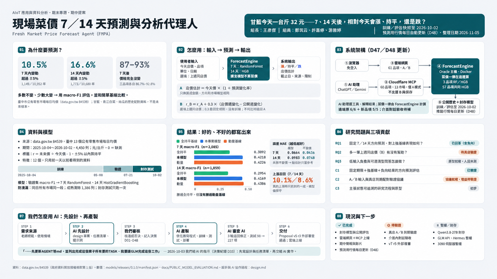

# 現場菜價 7／14 天預測與分析代理人（Fresh Market Price Forecast Agent）

**AIoT 應用與資料分析期末專題・期中提案 v8（2026-11-05：使用者原生 V8 修訂，20 頁 PPTX／PDF，影片實測 585.933333 秒；固定 SHA 的期中 V8 交付包已經另一 COS 獨立複審 EXTERNAL_PASS，並非整體期末專題／產品驗收）**
組長：王彥傑｜組員：鄭筑云、許嘉修、游雅婷｜正式發表日期：待填｜[期中交付](#期中交付v8)｜[目前實際運作的系統](#目前實際運作的系統2026-11-05)｜[本機重現入口](#本機使用與重現)見文末

圖中「2026-10-02」是凍結訓練與評估快照；預測用的公開行情自 2026-10-30 起每日自動更新（D48）。資訊圖表小字請放大閱讀，完整數值與限制以下方文字及 design.md 為準。

## 一句話情境

消費者站在蔬果行，看到今天甘藍一台斤 32 元——**未來 7／14 天，這個價格相對今天是漲、平還是跌？** 使用者輸入今天單品價格（上週同店同規格價選填），系統以臺中公開市場均價模型預測方向、以現價錨定估計店價，並附來源、期限與驗證狀態標示。

## 研究問題

| # | 問題 | 狀態 |
| --- | --- | --- |
| RQ1 | 臺中公開市場均價的固定 7／14 天方向預測，相對「不變價」與「動量」強基線表現如何？ | 已有封存測試答案（含負向結果） |
| RQ2 | 現價錨定（A）與選填上週同店價（B）的增益，如何以真店到期價驗證？ | 協議就緒；增益零證據，待驗證 |
| RQ3 | 低輸入負擔與可追溯呈現能否兼顧？ | 原型就緒；人因未測 |

## 三項貢獻（誠實標狀態）

1. **C1（已驗證）**：固定 7/14 日曆期限、強基線對照、含負向結果的臺中零售方向預測評估——材料可重現，預計隨課程交付公開。
2. **C2（待驗證）**：A/B 現價／上週價輸入與**真店到期配對驗證協議**（B 目前為 α=0.3 固定實驗規則，未訓練）。
3. **C3（初步）**：主張狀態可追溯的消費者端研究流程與原型（使用者效益未驗證）。

## 方法概覽

- **資料**：data.gov.tw 84539 臺中 13 市場每日零售均價（2025-10-04～2026-10-02；元/台斤；0=無價）。
- **標籤契約（凍結）**：r_h = m(t+h)/m(t) − 1；±5% 含邊界為持平；期限從使用者今天 t 起算之精確日曆日 t+7/t+14。
- **防洩漏**：時間切分＋成熟清除（兩段共 1,386 列）＋封存測試一次性。
- **模型**：驗證集 macro-F1 選型→7 天 RandomForest、14 天 HistGradientBoosting；輸入＝12 個數值特徵＋品項 one-hot。
- **A/B**：A 現價錨定（p>0 時 [p(1+r̂)−p]/p=r̂，同一 ±5% 分類器方向不變）；B 加上週價差動量（α=0.3 實驗規則）。

## 初步結果（正向與負向並列）

- 方向 macro-F1：7 天 **0.4218**、14 天 **0.4169**——勝全持平基線（0.3092/0.2954）、**未勝動量基線**（0.4226/0.4306）。
- 點估計 MAE **未勝不變價**（0.0664 vs 0.0436；0.0983 vs 0.0748）→ 點估計僅供參考。
- 上漲召回僅約 10%：模型偏保守報持平。無檢定不寫「顯著」。
- 誠實結論：我們交付的不是「很準的預測」，而是一個**誠實、可驗證**的預測與增益評估框架。

## 期中交付（v8）

教授要求（逐字稿第 4、5 週）：投影片不超過 20 頁、影片不超過 10 分鐘並放上 YouTube、放在 GitHub 且 README 就是報告、Design MD（計畫藍圖書）；期中只做 Introduction、Related Work、Proposal 三部分。

| 交付物 | 位置 | 狀態 |
| --- | --- | --- |
| 原生可編輯簡報（20 頁＝19 主講＋1 引用索引） | [V8 修訂 PPTX](slides/proposal_v8/FMPA_Proposal_v8_updated.pptx) | **固定成品 EXTERNAL_PASS**：作者61/61，另一COS獨立56/56最小來源重建、61/61全基準檢查及3/3反向拒絕；正式發表日期待填 |
| 簡報 PDF＋20 張原尺寸 PNG（同源） | [V8 PDF](slides/proposal_v8/FMPA_Proposal_v8_updated.pdf)・[渲染索引](slides/proposal_v8/README.md) | 最終PPTX與已實際Office匯出版本整檔SHA相同，沿用同源PDF／PNG；作者僅目視變動5頁，**另一COS獨立實看20/20原尺寸PNG及PDF逐頁文字20/20** |
| 同源備註、講稿與重建工具 | [講稿](slides/proposal_v8/SLIDE_NOTES_v8.md)・[備註 JSON](slides/proposal_v8/SLIDE_NOTES_v8.json)・[V8 重建說明](slides/proposal_v8/README.md) | 所有 20 頁旁白、PPT 備註與講稿對照已核對；原始 V8 未覆寫 |
| 配音影片（曉臻＋0%語音＋繁中同步字幕） | 本機 `recordings/midterm_v8_cos_20261105/FMPA_Midterm_v8_updated.mp4` 與同名 `.srt`（不入 Git） | 依最後20張PNG重編；**585.933333秒＝9:45.93＜期中10分鐘上限**，另一COS獨立13/13與174字幕核對；仍須真人聽校人名／專有名詞發音，YouTube未上傳 |
| 報告 | 本 README＋[研究提案全文](docs/PROPOSAL_REPORT.md)＋[Proposal v5 r3 主稿](docs/proposal_v5/PROPOSAL.md) | 完成 |
| Design MD（計畫藍圖書） | [design.md](design.md) | 2026-10-22 重寫版延續 D47／D48，現行入口補 V8 自驗狀態；§1 的 AI 設計／產製歷史、附錄 C 原文保持不變；整份新藍圖未經外部獨立審查 |

歷史 v7 由 33 頁 v5 r3 濃縮而成；本次 **v8 直接以使用者提供的 20 頁原生 V8 為唯一編輯底稿**。更新團隊名單、MCP 60 品項（D47）、每日推論行情（D48）、限制與交付狀態，同時修復 10 張原生表格的尺寸 metadata，增寬第 5 頁 Year 欄。科研數值、負向結論、模型與凍結資料沒有改動。可攜重建工具見 [來源說明](slides/source/proposal_v8/README.md)；作者原有SELF_CHECK 報告（本機 `outputs/quality_runs/v8_cos_20261105_01/author/AUTHOR_REPORT.md`，不入 Git）與另一 COS 的EXTERNAL_PASS 原文（本機 `outputs/quality_runs/v8_cos_20261105_01/independent_review/OUTPUT_REVIEW.md`，不入 Git）、20頁逐張目視（本機 `outputs/quality_runs/v8_cos_20261105_01/independent_review/visual_review.md`，不入 Git）分開留存（連結指向接回主專案後的報告目錄）。此 EXTERNAL_PASS 僅屬以下固定 SHA 的期中交付包，不沿用歷史 v5 r3 的外審結論：

PPTX `b863486b038aaf34175c9dc81d4c86d6ce27c5d51fe5a1dc10d941b62ce6c8d0`；PDF `eb0aefb27a46c91dfadd0aec09e90ddd5411f7c277bb2af5cdfc4869136f2175`；MP4 `210697d669e25ac1644b7f6f0d4ffcfbf9fd8c574723d8ac1a874d63179b47f0`；SRT `fedcf281dbdd1b77fa2d07af01de74552a232b9c40dbbb5b1bbed0bee0d157c3`，以及核實同源的20頁可編輯內容、PNG及講稿。最小來源重建是在**已有 Python/PowerPoint 環境的同機**完成，沒有在全新電腦安裝驗證。14組模型資產保護由主協調者在owner主樹另核對，這項**不是 reviewer2 的外審範圍**。期中20頁／9:45.93不能算成期末要求的 **超過20頁／超過10分鐘** 已達標。

## 目前實際運作的系統（2026-11-05）

| 入口 | 實際運作 | 限制 |
| --- | --- | --- |
| 瀏覽器 → 雲端網頁 | https://161.33.19.220/web/ ，免登入；61 個品項的 7／14 天預測、A／B 比較；紀錄只存在使用者自己的瀏覽器 | 原 3 品項用封存的 RF（7 天）／HGB（14 天）v0.1.0；其餘品項用 57 品項共同訓練的 HGB v1.0.0，[測試誤差未勝不變價](docs/deployment/POOLED_ML_MODEL_CARD_V1.md) |
| ChatGPT／Gemini 等 AI 助理 → MCP | Cloudflare Worker `https://fresh-market-price-agent.prometheans152.workers.dev/mcp` 提供兩個工具 `get_market_quote`、`post_forecast`；嚴格參數格式、四組流量限制、核對預測服務的回傳 | 2026-10-28 起支援 60 個有行情的品項（牛心柿無行情，不提供）、13 個市場，只有 A 模式；2026-11-05 起不說市場也能預測（`all_markets`＝13 個市場各自預測後取中位數，這種用法未經評估，D49）；不提供 B 與保存；遠端實測原 6/6＋新品項 5/5（D47）、全臺中參考 5/5（D49），但 ChatGPT／Gemini 介面內的實際對話驗收尚未做 |
| 兩條路的共同後端 | Oracle 主機上的 ForecastEngine（Docker），唯讀載入封存模型與公開歷史 | 訓練與封存評估資料仍至 2026-10-02、模型不重訓；預測用的公開行情自 2026-10-30 起每日自動更新（[D48](docs/ROLLING_PUBLIC_HISTORY.md)）。網頁內嵌「最近行情」文字仍可能是舊快照，文字顯示更新屬另一工作包 |

分工不變：AI 助理只選工具和解釋，菜價一律由 ForecastEngine 計算；AI 助理的解釋內容尚未驗證。本機原型（規則式 Agent＋`/records` 保存 API）保留，但不在雲端系統中。本機語言模型 Qwen3.8-27B 自 2026-10-17 **封存**（未刪除，見 [D46](docs/DECISIONS.md)）；GLM API、Hermes、SERVER_3090 仍暫緩。部署細節見 [Oracle 操作](deploy/docker/oracle/ORACLE_DOCKER_OPERATIONS.md) 與 [MCP 工具契約](deploy/cloudflare-workers-mcp/MCP_TOOL_CONTRACT.md)。

## 內容基礎：Proposal v5 r3（2026-10-09）

**狀態：第三輪 ChatGPT/COS 獨立複審 EXTERNAL_PASS，僅提案文件和 33 頁簡報。** 期中交付的 v7 簡報由它濃縮而成；外審結論不自動延伸到 v7 或整個期末產品。參閱 獨立審查報告（本機 `outputs/audits/proposal_v5_r3_independent_20261009_01/REVIEW_R3.md`，不入 Git） 與 [版本狀態](docs/proposal_v5/STATUS.md)。已驗收的 PPTX/PDF 原始快照保持不變。

| 內容 | 正式主入口 |
| --- | --- |
| Proposal 主稿 | [PROPOSAL.md](docs/proposal_v5/PROPOSAL.md) |
| Deep Research（五思維、三爭論、十問題） | [DEEP_RESEARCH.md](docs/proposal_v5/DEEP_RESEARCH.md) |
| 教授指定的八欄文獻表 | [ARTICLE_SUMMARY_TABLE.md](docs/proposal_v5/ARTICLE_SUMMARY_TABLE.md) |
| Agent Architecture、Flowchart、41行 Pseudocode | [AGENT_DESIGN.md](docs/proposal_v5/AGENT_DESIGN.md) |
| 可編輯簡報／同源 PDF | slides/proposal_v5/FMPA_Proposal_v5.pptx 與同名 PDF（23主講＋10附錄） |
| 講稿、來源與重建說明 | [逐頁講稿](slides/proposal_v5/SLIDE_NOTES_v5.md)・[來源](slides/proposal_v5/SOURCES.md)・[重建 README](slides/proposal_v5/README.md) |
| 工程設計與正式驗收 | [design.md](design.md) §7.5（CURRENT／PARTIAL／PROPOSED 對照）、§12（現況與限制）・[驗收狀態](docs/PROPOSAL_ACCEPTANCE.md) |

**尚未完成**：ChatGPT／Gemini 介面內的實際對話驗收與解釋正確性、同店到期價 A/B 增益、YouTube 上傳、GitHub 對教授開放、課程交件及正式發表日期。Qwen3.8-27B 封存；GLM/Hermes/SERVER_3090 暫緩。前述功能不能因 Proposal 通過而宣稱 PASS。

## 已完成／待驗證／暫緩（如實分列）

**已完成**：公開資料、封存模型與評估、模型包、HTTP API、手機 Web／規則 Agent 本機原型；Proposal v5 r3 文件與 33 頁簡報的獨立複審 PASS；歷史期中 v7 簡報與配音影片；**固定 SHA 的原生 V8 簡報、PDF、20頁講稿與9:45.93影片經另一COS獨立 EXTERNAL_PASS（只限此包）**；雲端網頁（Oracle，61 品項）與 MCP 服務（Cloudflare，2 工具）上線；MCP 已依 D47 擴充為 60 品項、13 市場的 A 模式，歷史遠端實測原 6/6＋新品項 5/5；2026-11-05 起不選市場也能預測（D49 全臺中參考）；預測用公開行情已依 D48 每日更新，凍結訓練資料、模型與評估不變。

**待驗證（有協議、未執行）**：真店 A/B 到期增益（T16，缺真店到期價）；B 之 α=0.3 未訓練；ChatGPT／Gemini 介面內對話與解釋正確性；使用者人因評估；參數敏感度與近期方法同資料比較。

**封存／暫緩**：Qwen3.8-27B **封存**（D46，不刪程式與文件、不自動恢復）；GLM API、Hermes、SERVER_3090 部署暫緩（D44；見 [代理人方向](docs/AGENT_RUNTIME_DIRECTION.md)）。外網展示改由上方的雲端網頁與 MCP 服務提供。

**未完成交付**：V8固定成品已獲獨立外審，仍須**真人發音聽校**，**YouTube尚未上傳**；GitHub仍為私人repo，尚未對教授開放；課程提交未進行；正式發表日期待填。這次期中20頁／9:45.93並未完成期末超過20頁／超過10分鐘的要求；真店到期A/B及AI介面內實際對話仍未驗收。

## 本機使用與重現

- 環境：Windows＋`.venv`（pandas 2.3.3、pyarrow 25.0.1、scikit-learn、python-pptx 1.0.2、matplotlib 3.11.2、pywin32 312、pypdf 6.19.0；PowerPoint（COM 匯出用）與微軟正黑體）。完整專案未做乾淨環境重建驗證；V8簡報所需最小來源已在獨立沙盒重建與檢查56/56。
- 啟動 API（規則模式展示）：`.venv\Scripts\python.exe -m uvicorn aiot_price.api.app:app`（端點見 [design.md](design.md) §8）。
- **期中 v8 重建與驗收**：以原始 `FMPA_Proposal_v8.pptx` 的 SHA-256 防護啟動 [rebuild.py](slides/source/proposal_v8/rebuild.py)，使用同機既有工具與封存輸入，依 [V8 README](slides/proposal_v8/README.md) 檢查來源、PDF／PNG與配音影片；作者報告（本機 `outputs/quality_runs/v8_cos_20261105_01/author/AUTHOR_REPORT.md`，不入 Git）及獨立複審原文（本機 `outputs/quality_runs/v8_cos_20261105_01/independent_review/OUTPUT_REVIEW.md`，不入 Git）分別存檔。歷史期中 v7 重建說明見 [slides/proposal_v7/README.md](slides/proposal_v7/README.md)。v5 重建見 [slides/proposal_v5/README.md](slides/proposal_v5/README.md)；勿覆寫已驗收的 v5 r3 PPTX/PDF。下列四項為歷史 v2 重建命令，僅供回溯：
  1. `.venv/Scripts/python.exe slides/source/build_stats_master.py --out <新run>/stats_master.json`
  2. `.venv/Scripts/python.exe slides/source/make_assets.py --out <新素材目錄> --stats <新run>/stats_master.json`
  3. `.venv/Scripts/python.exe slides/source/make_pptx.py --pptx <新pptx> --assets <素材> --notes slides/source/notes_v2.json --stats <新run>/stats_master.json`
  4. `.venv/Scripts/python.exe slides/source/export_and_render.py --pptx <新pptx> --render <新run>/render`
- 製作工具測試：`.venv/Scripts/python.exe -m pytest slides/source/test_make_tools.py -q`（15 項）。
- 版本管理：Git，已推送到私人 GitHub repo `prometheans152/FreshMarketPriceForecastAgent`（只推 `main`）；`data/`、`private/`、`models/`、`outputs/`、`recordings/` 不入庫。本機 main 可能有尚未推送的 commit；推送需另經使用者同意。

---
