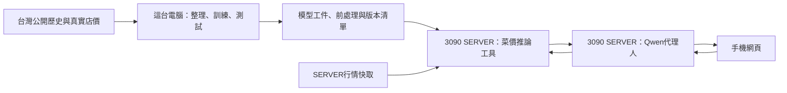

# TW01設計草案：現場菜價7／14天預測與分析代理人

更新日期：2026-10-03。工作題名，正式題名可在提案整理時調整。

**目前：使用者已要求以本案整理GLM完整執行任務；本文件是工程草案，尚無模型或系統實測。** 使用者明確指定這台電腦先訓練，另一台RTX 3090是SERVER。前一版「同一台3090主機訓練與服務」的助理建議已被取代。

執行依[完整TASKS](TASKS.md)，接手依[GLM指引](docs/GLM_HANDOFF.md)，資料與實驗依[模型驗證方案](docs/MODEL_VALIDATION_PLAN.md)。GLM前期完成資料與環境查核後，將本草案的技術選擇收斂並記入[決策紀錄](docs/DECISIONS.md)，不要把尚未測過的候選寫成實作成果。

## 1. 要完成的使用情境

一般使用者在蔬果行，以手機輸入菜名、今天價格及計價單位，查看7／14天後是否可能比今天貴。有上週同店同規格價格時可選填，並比較有／無這筆資訊的兩種結果。原菜籃預算、預計購買重量、整籃清單與整籃費用功能已被拒絕，不恢復。

日期／時間自動記錄；匿名店家、參考市場與上次選項盡量保留預填。來源對應和研究所需欄位不代表使用者每次都要手填技術ID或完整品質描述。沒有上週紀錄仍可完成查詢。

| 輸入方式 | 必需價格 | 額外價格 | 輸出 |
| --- | --- | --- | --- |
| A：無上週店價 | 今天同店報價 | 無 | 7／14天相較今天的方向與分析 |
| B：有上週店價 | 今天同店報價 | 上週同店、同品項／規格、同單位的報價及實際日期 | 同樣期限的方向與分析；可並列A供比較 |

兩者均可使用公開歷史；上週價格選填，不能用0或公開市場均價冒充。上週價格若來自另一家店、不同品種／品質／計價單位或不同促銷狀態，須處理不可比性，不直接當成店家調價趨勢。

## 2. 已確認與工程建議

**使用者已確認的方向：** 台灣公開訓練資料優先、實查前作、低輸入負擔、上述兩種使用方式，以及訓練機／SERVER分離。Qwen3.8為使用者提出的代理人候選，具體大小與量化版本未選。

**本文件的工程建議：** 先用已取得的臺中每日零售市場均價，先開發可重現的公開核心；初版品項可從甘藍、青江白菜、絲瓜的資料品質選取，數量與品項由前期查核收斂。推薦Python處理資料、訓練和HTTP服務，搭配手機網頁；演算法、API框架、Qwen執行框架與依賴版本由GLM實測後選定。不要因為有3090就規定菜價模型必須深度學習或必須使用GPU。

**尚缺的外部資訊：** SERVER位置／作業系統／登入方式／專案目錄／對外連線方案，組員與期限，最新期末交付細則，實際店價取得方式。只將依賴缺項的任務列BLOCKED，其餘繼續；不要求先取得全部答案才整理資料或訓練公開模型。

### 2.1 T02 首版收斂（2026-10-03）

以下為看最終測試前凍結的首版範圍，實作值以 [configs/project.yaml](configs/project.yaml) 與 [contracts/forecast.schema.json](contracts/forecast.schema.json) 為準：

| 項目 | 首版決定 | 狀態 |
| --- | --- | --- |
| 品項 | 甘藍（平地高麗菜）、青江白菜、絲瓜 | 依資料品質建議；T06 覆核後凍結 |
| 地域／市場 | 臺中市場均價（14 市場名稱，T06 查停用/沿用後定支援清單） | 同上 |
| 期限 | h=7、h=14 日曆日，起點固定為使用者今天 t | 凍結 |
| 持平門檻 | 相對變化 \|r_h\| ≤ 5% 為持平（整數元/斤、典型 25–60 元，1 元約 2–4%，<5% 無決策意義） | 凍結於看最終測試前 |
| 允許單位 | 元/台斤（原生）、元/公斤（×0.6 換算，依標準檢驗局 1 臺斤=0.6 公斤）；顆/把/袋無重量不可比，拒絕並說明 | 凍結 |
| 上週日期容許 | B 模式 previous_observed_at 須在 t−9～t−5（7±2 天）且單位規格可比；超出回 A 並警示 | 凍結 |
| 價格合理範圍 | 訓練集品項別 1/99 百分位＋人工覆核，T06 後定值 | 待 T06 |
| 目標類型 | 主目標相對變化 r_h 與三類方向（up/flat/down/insufficient_data） | 凍結 |
| 驗證範圍標示 | `target_scope`（market_mean／store_price_estimate）與 `validation_scope`（public_market_test／store_pilot／unvalidated）強制分離 | 凍結 |

## 3. 主機分工

| 節點 | 名稱 | 工作 | 目前已知 |
| --- | --- | --- | --- |
| TRAIN_LOCAL | 目前Windows工作機 | 資料整理、特徵、訓練、模型選擇、獨立測試、打包與本機整合 | 工作區為`C:/Users/prometheans/Documents/AIOT_FinishProject`；CPU／RAM／GPU與現有環境由GLM查核 |
| SERVER_3090 | 另一台RTX 3090 SERVER | 載入已訓練菜價模型、Qwen代理人推論、API、手機網頁服務與行情快取 | GPU型號已由使用者指定；OS、主機位址與授權連線資訊待提供 |
| CLIENT_PHONE | 使用者手機 | 填報價、選填上週價、查看結果 | 不在手機訓練模型 |



查詢時只載入已訓練工件推論。公開行情更新不等於重新訓練；模型更新先在TRAIN_LOCAL測試，再發佈工件到SERVER，保留可回退版本。不要默認在SERVER重新訓練菜價模型或微調Qwen。

## 4. 資料來源與可證明的目標

已讀來源見[臺中零售查核](docs/research/TW01_PUBLIC_RETAIL_DATA.md)。2026-10-03快照：2025-10-04～2026-10-02、4,450列、14個市場名稱、元／斤；0表示無該品項價格。原始檔在本機忽略目錄`data/retail_recheck/taichung/retail_prices_20261003.json`，SHA256為`172dffc76e8249026ac2ad89cc1a9f68bcfb686fd64a2820b38e949fe7e2e259`。實作前查當前下載、授權、欄位、日期、停用市場、重複與價格沿用情況，保留原快照。

**公開目標：** 同市場同品項的未來平均零售價格／方向；不是某一間蔬果行的真值。初版研究建議採日曆日t＋7及t＋14的價格，缺當日資料不能用最近一天暗替。方向門檻、發布延遲假設與用途須在看最終測試結果前寫入設定及方法紀錄。

**店家目標：** 同店同規格未來價格相較輸入當日價格。公開模型可以提供基礎走勢或待驗證店價估計；有／無上週店價的增益須用實際後續店價對照。不把PUBLIC的t−7再增加一欄當成新的私人資料，也不把公開均價模型的分數標為店家準確率。

若只是`今天店價 × 預測市場價／今日市場價`，方向完全取決於市場比值：可作簡單參考基線，不能聲稱現價輸入改善了方向。B的店家近期變化如何影響結果、需要哪種私人訓練真值，依[驗證方案](docs/MODEL_VALIDATION_PLAN.md)收斂；只有原型或規則時明示，不偽稱已訓練店家校正。

公開資料僅約一年，跨市場相關且期限重疊。按時間同步切分，所有訓練標籤在預測當時都要已成熟，最長14天標籤須從切分邊界清除重疊。訓練、驗證、測試分開；特徵／前處理僅用當時已可取得資料。最新公開訪價日不一定是今天，預測期限始終從使用者查詢今天算，不能改成快取日期＋7／14。

## 5. 菜價模型與Qwen的責任

- 菜價模型：用真實歷史標籤訓練，產生價格／方向；保留基線、7日與14日分開結果。選擇回歸或分類由資料／評估決定，不預設某個精準率或兩個演算法是老師要求。
- Qwen代理人：理解輸入、呼叫行情與菜價工具、依工具結果說明。不得自行編價格、概率、天氣原因、準確率或已完成的資料分析；工具失敗、資料不足或單位不可比時如實回覆。
- A／B比較：有真實上週與後續店價的同一組案例，分別隱藏／提供上週店價，使用相同公開資訊和截止時間。個別期限、品項、促銷與缺測分開報告；沒有改善也如實記錄。
- 顯示機率／區間：僅在對應目標完成獨立校準／涵蓋驗證後提供。未驗證時提供方向、依據、資料日期與限制，不假裝精確概率。

## 6. 工具契約與介面

GLM建立`contracts/forecast.schema.json`與`contracts/model-manifest.schema.json`，讓本機、SERVER、Qwen和網頁共用同一語意。下列是最小欄位，實作時可增加必要欄位，但不可移除來源和驗證邊界。

`ForecastRequest`：

| 欄位 | 意義與限制 |
| --- | --- |
| `crop_id`、`market_id` | 明確品項與公開參考市場；沒有合法對應則回不可估，不猜品種 |
| `store_id` | 匿名本機／家庭識別；不要求店家真名或地址 |
| `current_price`、`price_unit`、`observed_at` | 正價格、原始計價單位、含時區的今天報價時間；不能把久以前價格當現價 |
| `previous_price`、`previous_observed_at` | 上週價與實際日期可同時空白；日期／可比性不符則明示 |
| `mode` | `without_last_week`、`with_last_week`或`both`；後兩者缺歷史資料時說明B不可提供，仍可回A |
| `specification`、`promotion` | 保存規格與促銷可比資訊；不能把未知當「完全相同」 |

來源的元／斤與使用者輸入元／公斤換算須引用臺灣單位依據並驗證；一顆／一把沒有重量時不強行與每斤均價混比。價格合理範圍由品項資料與人工覆核定義，避免拒絕真實極端行情。

`ForecastResponse`至少包含：請求識別、執行模式、模型／資料版本、輸入和公開資料截止時間、每個期限的實際預測日期、方向（上漲／持平／下跌／資料不足）、可用價格估計、`target_scope`（市場均價／店價估計）、`validation_scope`（公開測試／指定店試點／尚未驗證）、警示與證據摘要。機率與區間可以空白，不用0代替未知。

`ModelManifest`至少包含：工件版本與SHA256、來源檔SHA256、來源授權、訓練時間範圍、時間切分、特徵schema與順序、缺測及單位處理、標籤／門檻／期限、模型及前處理版本、依賴與推論環境、訓練參數／seed、分期限指標與驗證適用範圍。不可只搬一個權重檔而漏掉前處理。

建議API：`GET /health`、`GET /metadata`、`POST /forecast`、`POST /agent/query`。前兩者不洩漏私人資料或主機憑證；後兩者驗證請求、回傳明確錯誤與版本。只有模型工件／schema／資料前處理相容時才標ready。

## 7. 建議程式與產出位置

這是GLM待建立的目錄方案，不代表程式已存在。

```text
src/aiot_price/
  data/          下載、清理、行情快取
  features/      僅使用當時可見資料的特徵
  models/        基線、訓練、評估與工件載入
  api/           參數契約、菜價推論服務
  agent/         Qwen連線與工具呼叫
web/             手機輸入、結果與必要互動
contracts/       預測與工件JSON schema
scripts/         可重現的訓練、評估與打包入口
tests/           資料／期限／工具／服務的重要行為檢查
deploy/          SERVER配置範本、啟停與回退指引
data/            本機原始與整理資料，Git忽略
private/         私人店價、登入設定，Git忽略
models/          模型與前處理工件，Git忽略
outputs/         詳細實驗、機器資訊與執行紀錄，Git忽略
docs/reports/    可公開的匿名彙總、結果與引用
```

精確函式／命令、依賴鎖定與測試契約由GLM前期收斂後同步到TASKS及文件。部署Windows訓練／可能不同OS的SERVER時，重播固定測試輸入確認輸出一致，記錄環境差異和容許數值誤差。

## 8. 部署與日常使用

在SERVER載入已通過本機測試的菜價工件；優先實測CPU推論是否夠用，Qwen使用3090。CPU/GPU與Qwen大小／量化／上下文／並行查詢數由實測決定，不承諾所有版本都放得下24GB。

先在有權限的SERVER專案目錄部署並驗證，再驗證手機從外部網路可實際取得資料／模型／代理人結果。僅同Wi-Fi、localhost、靜態頁、預錄影片或假工具回覆不能當外出使用完成。必要的對外連線、授權與TLS方案在明確目標上設定，不猜IP、網域、帳號或使用別案憑證。

不直接公開Qwen推論端口、模型管理功能或私人店價查詢；使用者介面經應用服務存取，按實際開放範圍配置存取控制、節流、日誌與資料保留。SERVER保持開機且服務正常才可使用；Qwen失敗時可顯示真實菜價模型結果，模型失敗時不能用LLM編一個替代預測。

行情刷新、模型發布、Qwen載入是不同操作，記錄各自版本／最後成功時間。更新模型採相容性檢查與固定輸入重播，失敗回到上一版；不要靜默替換結果或把無法取得資料當未漲。

## 9. 驗收與期末交付

1. **資料與公開模型：** 可重現取得／清理與授權、時間獨立測試、基線與7／14日分開結果、工件版本和測試證據。
2. **店家研究：** 真實上週、今日、未來同店價格和預測時資料截止時間；A／B配對比較。缺資料或不改善如實寫，不設定保證成功。
3. **SERVER系統：** 工件一致、真Qwen工具呼叫、手機兩模式、缺值／單位／過期／失敗處理、實際外網操作與可重啟／回退。
4. **課程交付：** 最新規則對照、問題／目的／前作／架構／方法／量化結果／限制、design.md、操作README、指定投影片／影片／程式庫與展示。老師1710模型、1722–1728工具呼叫、2832–2844網路成果可對應；期中影片清單不可當完整期末清單。

老師來源與讀取狀態見[課程要求](docs/COURSE_REQUIREMENTS.md)，前作見[菜價重查](docs/research/TW01_RELATED_WORK_RECHECK.md)。使用者要GLM完成本案不代表可以編造外部帳號或交付網址；目標與權限明確後執行相關任務，不在文件準備回合擅自發布。

## 10. 範圍與完成判定

本回合只完成文件和任務交接，未執行GLM、訓練、下載Qwen權重、登入SERVER或部署。GLM受使用者指示執行後，在本案範圍內完成常規本機環境、程式、資料、訓練與測試，不每一步重問；缺SERVER資訊／真店價／當屆交付公告時，列出所缺證據及可繼續工作。

不新增必需RAG、多代理人、OCR、天氣資料、菜單、換店推薦、Qwen微調或新IoT硬體。若實驗發現核心假設不成立，保留已完成成果及負面結果，提出具體調整；不靠新名字、漂亮網頁或不實準確率宣稱全部完成。
