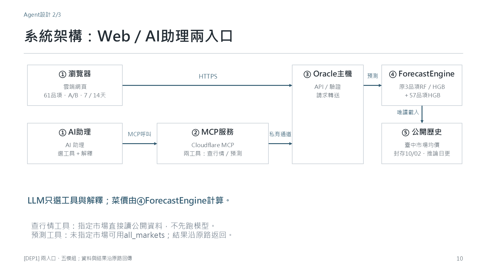
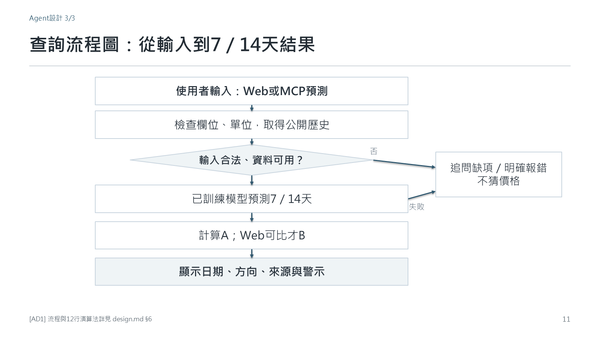

# DESIGN｜現場菜價 7／14 天預測與分析代理人

**Fresh Market Price Forecast Agent（FMPA）｜AIoT 應用與資料分析**  
組長：王彥傑｜組員：鄭筑云、許嘉修、游雅婷

[README：安裝／執行／Demo](README.md) · [完整 Proposal](docs/midterm/PROPOSAL.md) · [研究與來源](docs/midterm/RESEARCH_NOTES.md) · [封存測試 JSON](docs/midterm/public_test_results.json)

## 1. Problem & Requirements

使用者只有**今天單店蔬菜正價格、品項和單位**，希望知道今天起**精確 t+7／t+14 日曆日**的漲、平、跌。上週**同店、同品項、同規格、可換算單位**價格選填。系統必須標示市場資料日期、適用範圍和限制；缺必要欄位先追問，資料或模型失敗則明確報錯，不產生猜測的數字。公開市場均價**不是**個別店價的真值。

## 2. System Architecture



- **① 使用者入口**：Web 瀏覽器支援 A／B；AI 助理只理解提問、選工具與解釋結果，不自行計價。
- **② MCP 兩工具**：`get_market_quote` 要指定市場，直接查公開行情、不跑預測模型；`post_forecast` 僅匿名 A（不提供 B），未指定市場使用 `all_markets`。
- **③ Oracle API／網頁**：接收 Web／MCP 請求並驗證欄位；預測交④，行情讀⑤，結果沿原路回傳。
- **④ ForecastEngine**：原三品項用 RF（7 天）／HGB（14 天），擴充品項共用 HGB；價格由模型與程式計算。
- **⑤ 公開歷史**：臺中公有市場均價；訓練／評估封存至 2026-10-02，推論行情另每日更新。圖中主箭頭表示預測路徑，並非兩個工具都跑模型。

## 3. Components & Data Flow

| 步驟 | 資料／功能 | 介面責任 |
| --- | --- | --- |
| Input → Validate | 品項、今天正價格、元／台斤或公斤、含時區日期；上週價選填 | `web/`、`src/aiot_price/api/app.py`、`data/schema.py` |
| Retrieve → Features | 13 個公有市場歷史；0／缺價不作零元；只看 t−1 前資料 | `data/load.py`、`features/build.py` |
| Analytics → Domain | RF/HGB 產生公開均價相對變化，A 錨定店價；可比時 B 以固定規則調整 | `models/predict.py`、`models/store_adapter.py` |
| Output → Explain | 7／14 天各自日期、方向、參考價、來源、資料舊警示與驗證範圍 | API／Web／MCP；LLM 不重算、不得猜價 |

**市場未指定**：僅 `post_forecast` 的匿名 A 可走 `market_id=all_markets`；伺服端對**每個期限**分別取有效市場預測相對變化的中位數（至少 3 個、最多 13 個），再以今日店價錨定。查實際公開市價的 `get_market_quote` 仍須指定市場。

## 4. Data & Domain Knowledge

| 規則 | 定義 |
| --- | --- |
| 資料 | [臺中公有零售市場每日行情 84539](https://data.gov.tw/dataset/84539)；首版三品項甘藍、青江白菜、絲瓜，13 市場；封存訓練／測試到 **2026-10-02** |
| 單位 | 元／台斤；**1 台斤 = 0.6 公斤**，元／公斤 × 0.6；「一顆／一把」無重量不可換算 |
| 目標 | 同一市場品項 `r_h=m(t+h)/m(t)-1`，`h=7,14`，兩日都需有正均價；公開 0＝缺測 |
| 方向 | `r>+5%` 上漲、`r<-5%` 下跌、`−5%≤r≤+5%` 持平（含邊界，EPS `1e-9`） |
| 特徵 | 12 數值（前次價格／價齡、7／14／28 日均線、14 日波動／上下界、7／14 日動量、星期／月）＋品項 one-hot；不使用 `market_id` 或未來標籤 |
| 防洩漏 | 日期群組切分（同日不同市場同區）；標籤保守在 `t+h+1` 成熟，跨界未成熟共清除 **1,386 筆**（695+691） |

## 5. AI Model

正式首版以驗證集三類方向 macro-F1 選型：**7 天 RandomForestRegressor（300 棵、葉最少 5）**與 **14 天 HistGradientBoostingRegressor（200 輪、學習率 0.05）**，seed 42。先估相對變化再按 ±5% 分類；封存測試不參與調參。其他 57 品項使用後續擴充的共同 HGB，不能把它們的留出結果當作首版三品項成績。

**A 模式：** `p_A(t+h)=今天店價×(1+r_h)`；只是金額錨點，**不會提升相同市場方向的分類準確率**。**B 模式：** 同店、同品項同規格上週價且相距 7±2 天時，`r_B=r_A+0.3×(Δ店7日−Δ公開同期)`；`α=0.3` 為固定**未訓練**假設。不可比、缺上週價或缺同期公開行情都回 A 並說明。

## 6. Algorithm：Flowchart 與 Pseudocode

本節只描述 **Web 預測／MCP `post_forecast`**；`get_market_quote` 獨立查公開行情，不經預測模型。



**Algorithm 1：7／14 天菜價查詢（12 行）**

```text
01 收品項、今日價、單位、日期及入口；上週價選填
02 缺項追問；價格、單位或日期不合法就拒絕
03 換算元／台斤；MCP匿名A，缺市場用all_markets
04 只用t−1前歷史做特徵；資料不足就報錯
05 行情過舊先警示；公開均價不是今天店價
06 已訓練模型估計7／14天相對變動率
07 模型或工具失敗就報錯，不能猜價
08 全臺中參考：各期限取至少3個有效市場變動率中位數
09 A＝今日店價×（1＋相對變動率）
10 Web上週同店價可比時，依§5固定規則另算B
11 否則只有A；A／B按±5%分類，日期t＋7／14
12 回傳價、方向、日期、來源與警示；LLM只解釋工具值
```

**對照**：輸入／檢查／資料（PPT ①②③⑤）→01–05；模型④→06–08；A／B與沿原路返回→09–12。公開行情過舊先警示；沒有可用資料或模型失敗就明確報錯，不補數值。A／B 詳細公式見 §5。

## 7. Implementation Mapping & How to Run

| 模組 | 檢查入口 |
| --- | --- |
| `src/aiot_price/data/{load,labels,splits}.py`、`features/build.py` | `tests/data/`；單位／缺測／時間成熟 |
| `src/aiot_price/models/{train,predict,store_adapter}.py` | `tests/model/`；正式 RF/HGB、B 可比性、固定 α |
| `src/aiot_price/api/app.py`、`agent/tools.py` | `tests/api/`、`tests/agent/`；Web API 與兩個工具 |
| `deploy/oracle-forecastengine/all_markets/` | 分期限有效市場預測變動率中位數 |

安裝與本機 Demo 命令見 [README：Installation／How to Run](README.md)。HTTP 在 `AIOT_MANUAL_WEB=1`、`AIOT_RELEASE_DIR` 指定**真實模型包**時由 `python -m uvicorn --app-dir src aiot_price.api.app:app --host 127.0.0.1 --port 8000` 啟動，靜態頁面掛在 **`/`**；CLI 支援 `scripts/predict_local.py --request-file <JSON 檔>`。

## 8. Results（原封存測試，非新模型）

| 期限 | 模型 | n | macro-F1 | 動量 macro-F1 | 相對變化 MAE／不變價 MAE | 上漲 recall |
| --- | --- | ---: | ---: | ---: | ---: | ---: |
| 7 天 | RF | **2,085** | **0.4218** | **0.4226** | **0.0664／0.0436** | **10.1%**（16／158） |
| 14 天 | HGB | **1,859** | **0.4169** | **0.4306** | **0.0983／0.0748** | **8.6%**（23／268） |

來源：[公開封存結果原始精度](docs/midterm/public_test_results.json)。兩期限模型均**未勝動量 macro-F1**，回歸 **MAE 未勝不變價**；MAE 是市場相對變化誤差（非元、非店價）。網頁後續擴充品項與首版結果母體不同，不應混合排名。

## 9. 研究範圍與未來工作（Limitations / Future Work）

**目前範圍**：證據來自臺中公有市場均價，不能直接代表個別店價；全臺中聚合效果亦未獨立評估。原模型與簡單基線的完整比較見 §8。

**未來工作**：B 採固定 α=0.3 規則；後續蒐集同店同品項同規格的到期售價，配對比較 A／B 是否有增益。文獻與查核層級見[研究補充](docs/midterm/RESEARCH_NOTES.md)。
