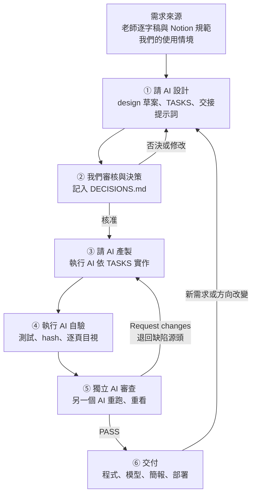
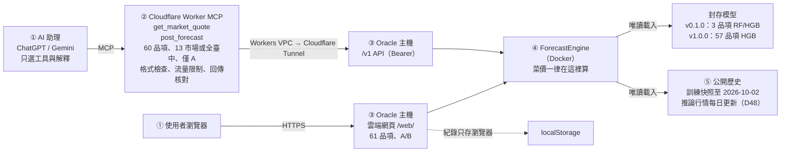
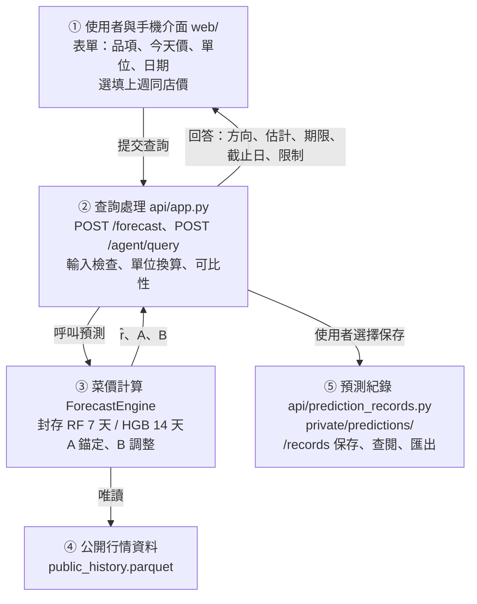
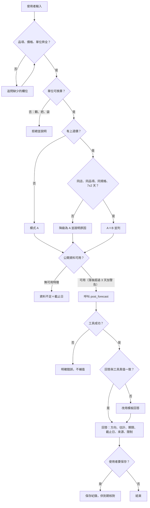
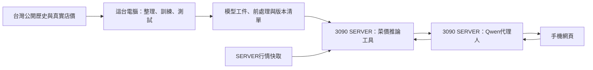

# 計畫藍圖書（Design MD）：現場菜價 7／14 天預測與分析代理人

**Fresh Market Price Forecast Agent（FMPA；選題期編號 TW01）**
更新日期：2026-11-05（2026-10-22 重寫版延續 D47／D48；期中固定 SHA 的 V8 簡報及影片已由另一 COS 獨立 EXTERNAL_PASS，僅限 V8 交付包）｜組長：王彥傑｜組員：鄭筑云、許嘉修、游雅婷｜整份新藍圖狀態：**未經外部獨立審查**

這份文件有兩個用途：

1. **系統設計規格**：需求、架構、資料、模型、代理人、介面、部署與驗收怎麼設計。
2. **AI 協作紀錄**：我們怎麼**先請 AI 設計**、經人審核後**再請 AI 產製**，產出又怎麼被另一個 AI 審查、退回、修正（第 1 章）。

2026-10-03 AI 寫出的第一份設計草案原文收錄在本文件附錄 C。研究內容以 [Proposal v5 r3](docs/proposal_v5/PROPOSAL.md) 為準，Agent 的 41 行完整虛擬碼在 [AGENT_DESIGN.md](docs/proposal_v5/AGENT_DESIGN.md)。

**狀態標記**（全文共用）

| 標記 | 意思 |
| --- | --- |
| `已實作` | 程式存在、有測試或實測紀錄 |
| `部分` | 有一部分可用，其餘尚未完成（會寫清楚缺什麼） |
| `規劃中` | 只有設計，尚未實作 |
| `暫緩／封存` | 使用者決定暫停或封存，不自動恢復 |

---

## 0. 一頁看懂這個專案

**情境**：你站在蔬果行，看到甘藍今天一台斤 32 元。這個價格 7 天、14 天後相對今天會**漲、持平還是跌**？

| 項目 | 內容 |
| --- | --- |
| 使用者輸入 | 品項、今天在這家店看到的價格、單位（元/台斤或元/公斤）、日期；**選填**：上週同店同規格的價格與日期 |
| 系統輸出 | 從今天起算精確 t+7、t+14 日曆天的方向（漲／平／跌／資料不足）、相對變化估計、店價估計，並附資料截止日、來源、驗證狀態與限制 |
| A 模式 | 只用今天店價＋公開歷史（現價錨定） |
| B 模式 | 再加上週同店價做實驗性調整（α=0.3 固定規則，**未訓練**） |
| 誰算菜價 | **ForecastEngine**（封存的 RandomForest／HistGradientBoosting 模型）。語言模型**只負責選工具與解釋**，不算價格 |
| 凍結訓練與評估資料 | 政府開放資料 data.gov.tw 84539：臺中市 13 個公有零售市場每日均價，2025-10-04～2026-10-02 |
| 預測用公開行情 | 自 2026-10-30 起每日自動更新（D48）；訓練快照、模型與封存評估不變 |

**目前上線的兩個入口**（2026-10-17 起；以下依 D47／D48 更新至 2026-11-05 的交接狀態）

- 瀏覽器：https://161.33.19.220/web/ （免登入，61 個品項，A／B 比較；紀錄只存在使用者自己的瀏覽器）
- AI 助理（ChatGPT／Gemini 等）經 MCP：`https://fresh-market-price-agent.prometheans152.workers.dev/mcp`（兩個工具，2026-10-28 起支援 60 個有行情的品項、13 個市場，只有 A 模式；不支援 B 與保存；歷史遠端實測原 6/6＋新品項 5/5，D47；ChatGPT／Gemini 介面內的實際對話尚未驗收。2026-10-20 的歷史紀錄顯示 ChatGPT 連接器尚未切換，當前設定與介面驗收仍待使用者確認）

**誠實的結果**：封存測試的方向 macro-F1 為 7 天 0.4218、14 天 0.4169，勝過「全猜持平」基線（0.3092／0.2954），但**沒有勝過動量基線**（0.4226／0.4306）；相對變化 MAE 0.0664／0.0983 **沒有勝過不變價基線**（0.0436／0.0748）；上漲召回只有約 10.1%／8.6%。我們交付的不是「很準的預測」，而是一個**誠實、可重現、可驗證**的預測與評估框架。

### 0.1 研究問題與三項貢獻

| 編號 | 內容 | 狀態 | 證據 |
| --- | --- | --- | --- |
| RQ1 | 臺中公開市場均價的固定 7／14 天方向預測，相對「不變價」與「動量」強基線表現如何？ | 已有封存測試答案（含負向結果） | §5.5；`models/releases/0.1.0/manifest.json`、評估 JSON／CSV（可重算） |
| RQ2 | 現價錨定（A）與選填上週同店價（B）的增益，如何以真店到期價驗證？ | 協議就緒；增益零證據（T16 HOLD） | §6.5 |
| RQ3 | 低輸入負擔與可追溯呈現能否兼顧？ | 原型就緒；人因未測 | §3、§8 |
| C1 | 固定 7／14 日曆期限、強基線對照、含負向結果的臺中零售方向預測評估 | 已驗證（含負向） | 封存評估 `outputs/evaluation/public/`（JSON＋CSV 可重算；在本機 outputs/，不上傳 GitHub） |
| C2 | A／B 現價與上週價輸入，以及真店到期配對驗證協議（B 為 α=0.3 固定規則，未訓練） | 協議就緒；增益待驗證 | A／B 協議與原型；缺真店到期價 |
| C3 | 主張狀態可追溯的消費者端研究流程與原型 | 初步；使用者效益未驗證 | 介面原型；主張→證據追溯表 `claims_master.csv`（在本機 outputs/，不上傳 GitHub） |

---

## 1. 我們怎麼用 AI：先設計、再產製

### 1.1 角色分工

| 角色 | 由誰擔任 | 做什麼 | 不能做什麼 |
| --- | --- | --- | --- |
| 決策者 | 我們（使用者／組員） | 定題目與方向、核准或否決 AI 的建議、授權部署與公開 | — |
| 設計 AI | 2026-10-03：對話式 AI 助理（決策紀錄只記為「助理」，工具名稱**待組員補填**）；2026-10-13 雙入口設計：Codex | 選題研究、寫第一版 design 草案、拆出 TASKS（T01–T36）、寫交給執行 AI 的完整提示詞 | 不得把建議寫成已接受的決定（[DECISIONS.md](docs/DECISIONS.md) 開頭規則） |
| 執行 AI | 2026-10-03～09：GLM coding agent（ZCode）；2026-10-13 起的雙入口與雲端部署：ChatGPT（透過 COS） | 依 TASKS 寫程式、整理資料、訓練模型、跑測試、寫文件、做簡報、部署，並自驗 | 只能給自己 `GLM_SELF_PASS`／`SELF_CHECK`，不能宣稱外部驗收通過 |
| 審查 AI | ChatGPT（透過 COS 操作本機檔案與命令） | 獨立審查 GLM 的產出、寫返修工作單與 D44 提案批的 GLM 提示詞、實讀老師的 Notion 規範 | 審查時不看作者的「全部通過」當依據，要自己重跑、重看 |
| 接手 AI | Claude Code | 2026-10-16 起推 GitHub、專案改名、線上服務遷移；2026-10-22 整理本文件 | 不自動 commit／push、不改模型與資料 |

分工規則寫在 [AGENTS.md](AGENTS.md)：「GLM 是執行者；ChatGPT（透過 COS）是外部獨立審查者」。原則是**同一份產出的作者與審查者不能是同一個 AI**；2026-10-13 起 ChatGPT 改當作者時，其產出只標 `SELF_CHECK`，外部驗收維持 HOLD。

### 1.2 整體流程



### 1.3 第一步：我們如何請 AI 設計

**觸發點**是 2026-10-03 確定以 TW01 為執行方向時，我們對 AI 下的這句指示（[DECISIONS.md](docs/DECISIONS.md) D33 原文）：

> 「在這台電腦先訓練好，3090那台是SERVER，先更新AGENT等md，並列出完成這個案子所有要的TASK，我要讓GLM完成這些工作」

也就是：**先不要寫程式，先把設計文件與完整任務清單寫好，再交給執行 AI。** 設計 AI 當天交出的設計產物：

| 設計產物 | 內容 | 位置 |
| --- | --- | --- |
| 設計草案 | 使用情境、A／B 兩種輸入、主機分工、資料來源、模型與代理人責任、工具契約、目錄方案、部署與驗收 | 本文件附錄 C |
| 完整任務清單 | T01–T36，每項有依賴與驗收條件 | [TASKS.md](TASKS.md) |
| 交給執行 AI 的提示詞 | 一段可直接貼給 GLM 的完整提示詞 | [docs/GLM_HANDOFF.md](docs/GLM_HANDOFF.md)「可直接交給GLM的完整提示詞」 |
| 模型驗證方案 | 時間切分、基線、A／B 配對驗證的方法 | [docs/MODEL_VALIDATION_PLAN.md](docs/MODEL_VALIDATION_PLAN.md) |
| 執行守則 | 工作範圍、狀態用語、不准造假的規則 | [AGENTS.md](AGENTS.md) |

**提示詞裡寫死的設計約束**（摘自 GLM_HANDOFF.md 2026-10-04 D41 修訂版，原文較長）：

- 菜價模型在本機訓練；另一台當 SERVER。
- 使用者輸入今天單品價格，上週同店同規格價格**選填**；沒有上週紀錄也要能用 A。
- 期限一律從使用者今天起算 7／14 天。
- 0 是無價格、元/斤不可當元/公斤、市場均價不是單店真值。
- 語言模型不得憑空猜價格、編準確率或機率；假工具、靜態頁、預錄影片不算完整代理人。
- 按時間切分，避免跨市場同日與 7／14 天標籤重疊洩漏；特徵只用當時已公布的資料。
- 沒有改善也要交代真實結果，不能刪掉不好的測試或換目標湊成功。
- 每完成一項就更新 TASKS 狀態，並在 [GLM_PROGRESS.md](docs/GLM_PROGRESS.md) 記錄實際命令與結果。

**先凍結、後測試**：機器學習的部分也照「先設計再產製」——門檻、期限、單位、選型標準、時間切分清單都在**看到封存測試結果之前**寫入設定並凍結（D34、D36；切分清單 SHA-256 `4e136574…`），測試只跑一次。這是避免「事後挑對自己有利的結果」。

### 1.4 第二步：AI 依設計產製

以下保留 2026-10-22 整理時的產製紀錄與歷史測試數，不當成本輪重新執行的結果；D47／D48 的後續變更另列於時間線與第 10 章。

| 設計項目 | AI 產出 | 程式／檔案位置 | 驗證方式 |
| --- | --- | --- | --- |
| 資料下載與清理 | 下載、轉長表、0→缺測、品質檢查 | `src/aiot_price/data/` | 下載快照記 SHA-256 與來源紀錄；品質報告 [DATA_QUALITY_REPORT.md](docs/DATA_QUALITY_REPORT.md)（下載、載入、品質檢查本身沒有單元測試） |
| 標籤與時間切分 | r_h 標籤、±5% 分類、成熟清除、凍結清單 | `src/aiot_price/data/labels.py`、`src/aiot_price/data/splits.py` | `tests/data/`：手算對照、切分與清除；切分清單 SHA-256 |
| 特徵 | 12 個只往回看的數值特徵 | `src/aiot_price/features/build.py` | 擾動未來資料，特徵不變（`perturbation_check`） |
| 模型與基線 | 5 種候選、3 種基線、驗證集選型、封存測試 | `src/aiot_price/models/` | [PUBLIC_MODEL_EVALUATION.md](docs/PUBLIC_MODEL_EVALUATION.md) |
| 模型包 | manifest＋兩個模型＋公開歷史＋固定測資 | `models/releases/0.1.0/` | 載入時驗兩個模型檔的 SHA-256；固定測資重播 |
| 本機 API | FastAPI 預測、代理人、紀錄端點 | `src/aiot_price/api/app.py` | `tests/api/` |
| 代理人 | 規則解析、白名單工具（規則路徑 2 個；LLM 路徑另加需使用者確認的 `save_record`）、呼叫次數上限、忠實性驗證器 | `src/aiot_price/agent/` | `tests/agent/` |
| 手機網頁 | 表單、A／B 並排卡片 | `web/` | 本機 E2E 截圖（期中簡報第 18 頁） |
| 雲端部署 | Oracle Docker、Cloudflare Worker MCP | `deploy/` | Worker 單元測試 45 項、遠端協定 6/6 |
| 研究文件與簡報 | Proposal、文獻表、Deep Research、33 頁與 20 頁簡報 | `docs/proposal_v5/`、`slides/proposal_v5/`、`slides/proposal_v7/` | v5 r3 外部審查（含 33 頁獨立目視）；v7 r4 歷史 `check.py` 67/67、與 v6 逐像素比對、變動頁原解析度目視 |

### 1.5 實際時間線

| 日期 | 發生什麼 | 誰 |
| --- | --- | --- |
| 2026-10-03 | 選題：AI 依序整理多批候選題（1–50、N、W、U、G、H 批），我們否決大部分；我們提出把 TW01 從「菜籃預算」改成「現場報價 7／14 天」（D21，討論中），否決整籃流程（D24：「不要，太不方便」），再提出有／無上週價兩種預測（D30，討論中） | 我們＋設計 AI |
| 2026-10-03 | D33：我們要求先寫 md 與完整 TASK，再交給 GLM；設計 AI 交出 design 草案、TASKS T01–T36、GLM 提示詞 | 我們＋設計 AI |
| 2026-10-03 | GLM 第一輪：T01–T15、T17–T22 共 21 項自驗通過；凍結範圍（D34）與模型（D36）；封存測試跑一次；模型包 v0.1.0 | 執行 AI |
| 2026-10-04 | 工程審查迴圈：7fdb43b、44dabe3、f146b97 三輪都是審查→退回→修正，測試數 98 → 134 → 192 → 227；GLM 第五輪修正（2f7199e）之後的第五輪獨立審查，其缺陷因 D44 轉向而暫緩、未關閉 | 審查 AI ↔ 執行 AI |
| 2026-10-04 | D41：我們指定本機語言模型 Qwen3.8-27B、GLM API 先行 | 我們 |
| 2026-10-04 | D44：我們決定暫停代理人整合，改做六個工作包（研究動機、相關研究與差異、三項貢獻、設計藍圖、OpenSpec、正式投影片）；不做代理人修復、GLM／Qwen 接線、SERVER 部署、重訓模型，現有介面只當展示載體；ChatGPT 先寫來源核對、六包執行計畫與 GLM 提示詞（又一次先設計），GLM 再產出 v1 簡報，兩輪審查後修到 v3 | 我們＋ChatGPT＋GLM |
| 2026-10-08～09 | Proposal v5：r2 審查要求修改（表格錯版、Year 欄、Agent 角色誤標），r3 外部審查通過（只限提案文件與 33 頁簡報，不延伸到期中 v7 簡報） | 執行 AI＋審查 AI |
| 2026-10-13 | 同樣「先設計再產製」：我們要 Codex 先寫雙入口的結論、TASKS 與工作提示詞（保留網頁表單、新增本人 ChatGPT 的 MCP 工具），再由 ChatGPT 用 COS 依文件實作，結果標 `SELF_CHECK` | 我們＋Codex＋ChatGPT |
| 2026-10-14 | Oracle 雲端主機上的 ForecastEngine 上線並驗收 | ChatGPT（COS） |
| 2026-10-15 | 61 品項網頁、57 品項 HGB 模型 v1.0.0、Cloudflare Worker MCP 遠端實測 6/6、Oracle 改 Docker | ChatGPT（COS） |
| 2026-10-16 | 交接 Claude Code（任務：推上私人 GitHub、改名、遷移線上服務）；D45 專案改名 FMPA | 我們＋接手 AI |
| 2026-10-17 | D46：Qwen3.8-27B 封存；期中簡報 v7（20 頁）；改名後的 Worker 實測 6/6（日期依 README） | 我們＋AI |
| 2026-10-18 | 期中 v7 簡報＋9 分 35 秒配音影片完成 | — |
| 2026-10-22 | 整理本藍圖書 | 接手 AI |
| 2026-10-28 | D47：MCP 擴充為 60 個有行情品項、13 個市場，仍只有 A 模式；原 6/6＋新品項 5/5 為當時遠端實測，介面內對話仍未驗收 | 使用者授權的後續工作（見 DECISIONS.md D47） |
| 2026-10-30 | D48：預測用公開行情開始每日更新，凍結訓練快照與模型保持不變；不把每日更新當成重訓 | 使用者授權的後續工作（見 DECISIONS.md D48） |
| 2026-11-05 | 以使用者提供的2026-10-22完整藍圖與README修訂D47／D48；期中原生V8簡報／影片已完成SELF_CHECK（61/61、可攜56/56、影片13/13及9:45.93），沒有新增COS獨立外審或公開交付 | Codex／COS |

### 1.6 第三步：AI 審查 AI——品質關卡

我們不讓執行 AI 自己說「完成」就算數。[AGENTS.md](AGENTS.md) 規定：

- **十關管線**（S00–S99）：環境與範圍 → 需求與來源 → 研究證據 → Agent 設計 → 文件一致性 → 簡報產生 → 自動與反向測試 → 逐頁目視 → **S80 交給 ChatGPT 獨立複審** → S90 部署與公開需另外授權。
- **六個檢查點**：輸入產生／輸入審核、實作／實作審核、輸出產生／輸出審核。審核者不看作者的自驗結論，直接重跑命令、重看每頁渲染圖、重算數字。
- **狀態分開**：執行 AI 只能標 `GLM_SELF_PASS`；只有獨立審查能給 `EXTERNAL_PASS`。
- **退回規則**：發現重要缺陷就退回缺陷最早的源頭那一關；同一原因連續失敗兩次，就停下來查根因，不能無限重試到全綠。
- **反向測試**：每個檢查器都要準備故意做錯的輸入，確認它真的會失敗（例如故意讓表格欄寬總和不對）。

另外用 [OpenSpec](docs/OPENSPEC_WORKFLOW.md)（1.14.0）管理提案批次的工程變更：change `prepare-tw01-proposal-package` 有 proposal、design、specs（research-evidence、proposal-delivery）、tasks 四份工件，`validate --strict` 通過。OpenSpec 管理的是工程變更規格：CLI 驗證通過不等於系統功能驗收，也不會因 Proposal 外部審查通過，就把 Agent、實測、部署相關工件標成通過；這一批也沒有擴大既有 OpenSpec 變更的實作範圍。

### 1.7 審查抓到的錯誤與修正（實例）

| 審查輪 | 抓到的問題 | 修正 |
| --- | --- | --- |
| 7fdb43b（10-04） | 「今天一斤 32，上週一公斤 50」兩筆都被當成公斤 | 改成逐子句綁定單位 |
| 7fdb43b | 提示檔路徑錯，讀到空提示；捏造的「必定上漲 99%」也能通過 | 修路徑，並加上輸出忠實性驗證器 |
| 7fdb43b | 用 chunked 傳 9,198 bytes 可繞過 8 KB 上限 | 改依實際位元組數回 413 |
| 7fdb43b | 設計寫的是「Qwen理解、呼叫工具與解釋」，實作的 Qwen 卻只拿已執行工具的結果做解釋，沒有工具呼叫迴圈 | 任務狀態由 PASS 退回 DOING，本機與 SERVER 證據分開記錄 |
| 44dabe3 | 7 天與 14 天的數字互換，驗證器仍判通過 | 驗證改成期限×模式×單位綁定 |
| 44dabe3 | 偽造的預測結果可以被保存 | 保存改成只收伺服器產生的 `request_id` |
| f146b97 | `max(1, …)` 讓工具多執行一次 | 改成真正的上限 |
| 6eb4adf（提案） | 新聞日期、作者姓名寫錯；同一個數字出現三種口徑 | 查原文更正；統一為 10.5%／16.6% |
| 9c7ed21（簡報） | 匯出腳本會關掉使用者開著的 PowerPoint；缺 UI 截圖仍照常輸出 | 加所有權檢查；缺圖時非零退出 |
| v5 r2（簡報） | 第 3、4 頁表格欄寬總和不等於宣告的滿寬 11.93 吋；第 5、24–26 頁 Year 欄只有 0.46 吋，放不下四位年份 | 生成器加 `validate_table_geometry()`、7 個故意造錯的反向測試；Year 欄加寬到 0.76 吋 |
| v7 自查 | 第 13 頁兩列文字換行把表格撐高，壓到下方裝飾線；自動檢查沒抓到（它讀的是設定列高） | 刪除重複列並預留兩行高度；改以原解析度目視變動頁 |

### 1.8 設計怎麼隨決策改變

| 原本的設計 | 改成 | 原因 | 決策 |
| --- | --- | --- | --- |
| 菜籃預算：填下次品項與重量，估整籃花費 | 現場單品報價、7／14 天方向 | 使用者覺得太麻煩 | D24 |
| 只有一種預測 | A（無上週價）／B（有上週價）兩種 | 使用者提出比較有無上週價 | D30 |
| 同一台機器訓練與服務 | 本機訓練（TRAIN_LOCAL）、3090 當 SERVER | 使用者指定 | D33 |
| 研究差異主張 | 收縮為「查核範圍內未見的組合」，不宣稱原創 | 實查發現現場輸入比價、零售價格預測等單一元件都有台灣前作 | D37 |
| Qwen 解釋層 | 可切換供應商（GLM API／Qwen） | 使用者要求 GLM 先行 | D41、D42 |
| 先修代理人 | 暫停代理人，先完成提案 | 期中提案優先 | D44 |
| SERVER_3090＋Qwen 對外 | Oracle 雲端網頁＋Cloudflare MCP，由 ChatGPT／Gemini 當代理人介面 | SERVER_3090 連線資訊始終未提供（T23 HOLD）、Qwen 暫緩；老師提到成果要「在網路上可以看到」、「你做的東西是會動的」 | 2026-10-13～15 |
| Qwen3.8-27B 本機模型 | 封存（不刪、不規劃、不自動恢復） | 使用者決定 | D46 |
| 33 頁提案簡報 | 20 頁 v7 | 老師要求 20 頁以內 | 2026-10-17 |
| MCP 只開放原 3 品項 | 與網頁共用有行情的 60 品項，仍只有 A 模式 | 使用者要求擴充現場報價預測 | D47 |
| 凍結公開歷史同時用於訓練與推論 | 凍結訓練快照保留，推論改讀每日滾動行情 | 使用者要求最新行情且不重訓 | D48 |
| MCP 預測必須指定 13 個市場之一 | 可用 `all_markets`：13 個市場各自預測後取中位數（全臺中參考，未經評估） | 使用者要在路邊果菜店直接預測、不想選市場 | D49 |

### 1.9 這次 AI 協作的原則

1. **先寫設計與任務，再寫程式**：每個任務都有驗收條件，AI 照清單做，不自己另起計畫。
2. **人做決定，AI 做建議**：AI 的建議沒經我們同意，不寫成「已決定」。
3. **作者與審查者分開**：寫的 AI 不能自己宣布通過。
4. **數字以封存檔為準**：簡報與報告的數字都對回封存的評估 JSON，不重訓、不換指標讓結果變好看。
5. **負向結果照實寫**：沒勝過基線就寫沒勝過。
6. **語言模型不算菜價**：這條同時是系統設計規則（第 7 章），也是我們對 AI 協作的態度——數字一律來自可重算的程式。

---

## 2. 需求規格

### 2.1 使用者故事

> 身為在蔬果行買菜的消費者，我想輸入今天看到的價格，就知道 7 天和 14 天後相對今天大概會漲、持平還是跌，而且要知道這個判斷根據什麼、可信到什麼程度。

### 2.2 功能需求

| 編號 | 需求 | 狀態 |
| --- | --- | --- |
| FR-01 | 輸入品項、今天價格、單位、日期，得到 t+7／t+14 的方向與估計 | `已實作` |
| FR-02 | 選填上週同店同規格價格，並排顯示 A 與 B | `已實作`（網頁）；MCP 只開放 A |
| FR-03 | 上週價不可比（換店、換規格、跨品項、日期不在 7±2 天）時自動退回 A 並說明原因 | `已實作` |
| FR-04 | 單位為元/公斤時自動換算為元/台斤；顆、把、袋等無重量單位拒絕並說明 | `已實作` |
| FR-05 | 每個結果附資料截止日、來源、`target_scope`、`validation_scope` 與限制 | `已實作` |
| FR-06 | 自然語言查詢：缺必要資訊時追問，不猜 | `已實作`（本機規則解析）；雲端由 ChatGPT／Gemini 理解 |
| FR-07 | AI 助理可透過白名單工具查行情與預測 | `已實作`（MCP 兩工具）；介面內對話驗收 `部分` |
| FR-08 | 使用者自願保存預測，供 7／14 天後到期核對 | `已實作`（雲端存瀏覽器；本機存伺服器 `/records`） |
| FR-09 | 到期時以同店實價比較 A 與 B 的增益 | `部分`：保存與匯出已有，真店到期價尚未收集（T16） |
| FR-10 | 每日自動更新公開行情 | `已實作`：自 2026-10-30 起更新雲端推論行情（D48）；訓練快照、模型與封存評估不變 |

### 2.3 領域規則（全部寫成程式規則，不交給語言模型判斷）

| 編號 | 規則 | 程式位置 |
| --- | --- | --- |
| DR-01 | 0 代表當日無報價（缺測），不是 0 元 | `src/aiot_price/data/load.py` |
| DR-02 | 公開資料單位「元/斤」解讀為元/台斤；1 台斤＝0.6 公斤 | `src/aiot_price/data/schema.py`（`TAIWAN_JIN_TO_KG = 0.6`） |
| DR-03 | 期限從使用者今天 t 起算精確 t+7、t+14 日曆天，不因資料截止日較早而改起點 | `src/aiot_price/models/predict.py` |
| DR-04 | 相對變化 \|r\| ≤ 5%（含邊界）為持平；r̂ 為負不等於「跌」 | `src/aiot_price/data/labels.py`、`src/aiot_price/models/baselines.py` |
| DR-05 | 公開市場均價不是單店真值；市場測試分數不能當店價準確率 | 輸出欄位 `target_scope`、`validation_scope` |
| DR-06 | B 的上週價要同品項、同規格、單位可比、日期在 t−9～t−5；「同店」由使用者聲明（請求沒有上週店號欄位），自然語言路徑會偵測換店字樣並拒絕 B | `src/aiot_price/models/store_adapter.py`、`src/aiot_price/agent/tools.py` |
| DR-07 | 不用 0、公開 t−7 價或市場均價冒充使用者的私人店價 | `src/aiot_price/models/store_adapter.py`、`src/aiot_price/agent/providers.py`（TrustedContext） |
| DR-08 | 原 3 品項價格超出合理範圍（1／99 百分位；manifest 寫「全期」、DATA_QUALITY_REPORT 寫「訓練區」，兩處不一致待釐清）不拒絕，但附警示 | manifest `price_sanity_jin` |

### 2.4 安全與誠實約束

1. 沒有 ForecastEngine 的成功結果，就不產生任何預測數字。
2. A／B 計算一律由程式執行。
3. 語言模型不得修改價格、方向、日期、來源；不得編造漲價原因、準確率、信心機率或省錢金額。
4. 工具失敗時明確告知，不用語言模型補值。
5. 工具只能從白名單選，參數經過伺服器端格式檢查；不開放任意網址、檔案或指令。
6. 機率與預測區間未經校準，一律回傳 `null`。
7. 金鑰只放環境變數或 secret，不進提示詞、日誌或 Git。

### 2.5 非目標（刻意不做）

整籃採買與預算、菜單、換店推薦、天氣因果解釋、RAG、多代理人、OCR、自製 IoT 硬體、微調語言模型、用語言模型直接預測價格。

---

## 3. 系統架構

### 3.1 目前上線的雲端系統 `已實作`

對應期中簡報 v7 第 10 頁，編號與簡報相同；①–⑤ 是功能群組索引，不是執行順序。下一步（尚未上線）：同店到期驗證、AI 助理介面內對話驗收、分析工具。預測用行情已自 2026-10-30 起每日自動更新（D48），訓練快照與模型保持凍結。2026-11-05 起 `post_forecast` 可不指定市場（`all_markets`，D49）：13 個市場各自預測後，取有效市場（至少 3 個）相對變化的中位數，結果標明為未經評估的全臺中參考；`get_market_quote` 仍要指定市場。



| 元件 | 職責 | 位置 |
| --- | --- | --- |
| 雲端網頁 | 表單輸入、A／B 並排、紀錄存瀏覽器 | `deploy/oracle-forecastengine/`（`oracle_web_site_ml.py`、`build_web_assets.py`） |
| Cloudflare Worker MCP | 兩個工具、參數驗證、四組流量限制、核對 ForecastEngine 回傳 | `deploy/cloudflare-workers-mcp/src/` |
| ForecastEngine API | `/healthz`、`/v1/market-quote`、`/v1/forecast` | `deploy/oracle-forecastengine/forecastengine_api.py` |
| 網頁預測端點 | `/site/forecast`（同源檢查），與 API 由 `oracle_web_site_ml.py` 組合成同一服務 | `deploy/oracle-forecastengine/oracle_web_site.py` |
| Docker 堆疊 | forecast、mcp（自架備用 MCP，不是 Worker 的上游）、web（Nginx）三個容器，都是唯讀檔案系統；forecast 以非 root 執行 | `deploy/docker/` |

部署細節見 [Oracle 操作](deploy/docker/oracle/ORACLE_DOCKER_OPERATIONS.md)、[MCP 工具契約](deploy/cloudflare-workers-mcp/MCP_TOOL_CONTRACT.md)、[改名搬遷紀錄](deploy/RENAME_MIGRATION.md)。研究數字與結論不因部署而改變。

### 3.2 本機原型（五個功能群組） `已實作`，不在雲端系統中



數字①–⑤是功能群組索引，不是執行順序（與期中簡報 v3 第 8 頁同一套編號）。

**對照解說**：①接收使用者的表單或自然語言查詢，交給②；②檢查必要資訊（品項、今天價、單位、日期；自然語言缺項就追問），驗證單位與上週價的可比性（不可比自動退回 A 並說明），通過後呼叫③；③唯讀載入④的公開歷史，用封存模型算出 r̂_7／r̂_14，再做 A（現價錨定）與 B（有可比上週價時的調整），結果經②回到①，附期限、資料截止日、來源與驗證狀態。只有使用者選擇保存時，②才把當次請求＋回應凍結寫入⑤；之後的查閱、匯出與 7／14 天到期核對也經②回到①。④與⑤之間沒有連線：公開資料唯讀，私人紀錄另存。

- **已運行（本機）**：①–⑤的模組、API 與資料流都已具備。②是規則式的固定工具序列，⑤的保存由網頁另外呼叫 `/records`；這**不代表**已有自主選工具的 LLM Planner（逐項狀態見 §7.5）。
- **暫緩未來區（未部署、未驗收）**：GLM API、Hermes 0.19.0 暫緩；Qwen3.8-27B 自 2026-10-17 封存（D46）。它們原本規劃負責②裡的「理解與解釋」，不是用語言模型猜菜價——菜價一律由③計算。SERVER_3090 部署與外網手機展示（T32）暫緩，外網展示改由 §3.1 的雲端系統提供。

### 3.3 責任分層

```text
語言層（AI 助理／規則解析）：理解請求、追問缺漏、選工具、依結果解釋
        │ 只能呼叫白名單工具，參數經格式檢查
        ▼
工具層（get_market_quote／post_forecast）：查行情、送預測請求、核對回傳
        │
        ▼
計算層（ForecastEngine）：特徵 → 模型 → 方向 → A 錨定 → B 調整
        │ 唯讀
        ▼
資料層（封存模型＋公開歷史；模型檔載入前驗 SHA-256；雲端推論行情每日更新）
```

---

## 4. 資料設計

| 項目 | 設計 |
| --- | --- |
| 來源 | 臺中市政府每日蔬果價格 data.gov.tw/84539（政府資料開放授權條款第 1 版） |
| 原始快照 | 2026-10-03 下載；4,450 列、63 欄、14 個市場名稱、2025-10-04～2026-10-02；JSON SHA-256 `172dffc7…` |
| 排除 | `(停)建國市場`（停用且沿用價密集），剩 13 個市場 |
| 單位 | 元/台斤（市場均價） |
| 缺測 | 0、負值、無法解析 → NaN，並計數 |
| 首版品項 | 甘藍（平地高麗菜）、青江白菜、絲瓜（依資料品質選出） |
| 擴充品項 | 雲端網頁列出資料集全部 61 個價格欄（蔬菜 15、水果 27、魚海鮮 7、肉 10、蛋 2）；牛心柿歷史全為 0，顯示但停用預測；原 3 品項用 v0.1.0 模型，其餘 57 項用共同 HGB 模型 |
| 品質檢查 | 重複鍵、覆蓋率、日期斷點、連續 10 天以上同價、跨市場同價、價格分布（`src/aiot_price/data/quality.py`） |
| 本機手動更新 | `scripts/update_public_data.py`：備份 → 暫存檔 → 逐列核對 → 原子替換；不動模型、manifest、固定測資；退出碼 0 為成功，1–5 分別代表各失敗階段 |
| 雲端推論更新 | D48 的 `deploy/oracle-forecastengine/rolling_history/` 每日更新公開行情；版本切換前核對欄位、日期、價格、列數與凍結前綴；訓練快照不變，0 仍為缺測；來源與設計見 [ROLLING_PUBLIC_HISTORY.md](docs/ROLLING_PUBLIC_HISTORY.md) |

**問題確實存在**（本案資料實算）：三個品項 7 天內脫離 ±5% 持平區的歷史配對比例為 10.5%（1,149／10,952），14 天為 16.6%（1,773／10,680）；但 7 天完全同價的配對也接近九成。「多數不變、少數大變」決定了我們用 macro-F1 並與簡單基線比較。

---

## 5. 預測模型設計

### 5.1 預測目標

- 標籤：r_h = m(t+h) / m(t) − 1，m 為同市場同品項均價，h ∈ {7, 14}。
- 方向：r > +5% 為漲、r < −5% 為跌、其餘持平；缺資料為 `insufficient_data`。
- 標籤成熟日 = t+h+1（假設資料發布延遲 1 天）。
- ±5% 的理由：公開價是整數元/台斤，首版品項多在 25–60 元，1 元約等於 2–4%；±5% 以內的變化對現場買不買沒有實質意義。門檻在看到測試結果前凍結。

| 例子 | 計算 | 方向 |
| --- | --- | --- |
| 27 → 25 元 | r_7 = 25 ÷ 27 − 1 = −7.4% | 跌（[LABEL_CONTRACT](docs/LABEL_CONTRACT.md) E1） |
| 30 → 31.5 元 | r = +5.0%，剛好在邊界 | 持平（含邊界，E2） |

### 5.2 特徵（只用 t−1 以前可見的資料）

12 個數值特徵＋品項 one-hot：

| 特徵 | 意思 |
| --- | --- |
| `price_last`、`price_last_age_days` | 最新可見價、該價距今幾天 |
| `ma7`、`ma14`、`ma28` | 7／14／28 日移動平均 |
| `std14`、`min14`、`max14` | 14 日波動、最低、最高 |
| `ret_7d`、`ret_14d` | 過去 7／14 日變化 |
| `dow`、`month` | 星期、月份 |

訓練與推論共用同一個 `build_features()`，用 `merge_asof` 只往回看。

### 5.3 時間切分與防洩漏

| 區段 | 起算日 t |
| --- | --- |
| 訓練 | 2025-10-04～2026-05-08 |
| 驗證 | ～2026-07-21 |
| 封存測試 | 2026-07-22～2026-10-02（73 個日期，只跑一次） |

- 同一天的所有市場放在同一區段，避免跨市場同日資訊外洩。
- 成熟清除：標籤成熟日（7 天目標為 t+8、14 天目標為 t+15）跨進下一區段的列剔除。實際清除如下（2026-10-04 依 `features_labels.parquet` 的 `purge_reason` 分組重算，與獨立複審同口徑）：

| 邊界 | 7 天目標 | 14 天目標 | 小計 |
| --- | --- | --- | ---: |
| 訓練 → 驗證 | 2026-05-02～05-09（8 日、242 列） | 2026-04-25～05-09（15 日、453 列） | 695 列 |
| 驗證 → 封存測試 | 2026-07-14～07-21（8 日、243 列） | 2026-07-07～07-21（15 日、448 列） | 691 列 |

  兩個邊界合計 1,386 列、聯集 30 個起算日。兩個期限的清除帶長度不同（8 日 vs 15 日），不是單日空檔；提案簡報 v3 第 9 頁的切分圖（圖三）以聯集呈現並標註期限差異。這是圖文一致性的修正，不是新發現的洩漏，也沒有重新切分。
- 切分清單凍結並記 SHA-256（`4e136574…`），評估時重新校驗。

### 5.4 候選、基線與選型

| 類別 | 內容 |
| --- | --- |
| 候選模型 | Ridge、HistGradientBoosting 回歸、RandomForest 回歸、HistGradientBoosting 分類、多數類 |
| 基線 | 全猜持平（不變價）、動量（過去變化延續）、訓練期品項平均變化 |
| 選型規則（看測試前凍結） | 驗證集方向 macro-F1 最高者 |
| 選定 | 7 天 RandomForest（300 棵樹、葉節點 ≥5）驗證 0.4334；14 天 HGB（200 輪、學習率 0.05）驗證 0.4591；seed 42 |

### 5.5 封存測試結果（含負向結果）

| 期限 | 模型 | n | macro-F1 | 全持平 | 動量 | 相對變化 MAE | 不變價 MAE | 上漲召回 |
| --- | --- | ---: | ---: | ---: | ---: | ---: | ---: | ---: |
| 7 天 | RF | 2,085 | **0.4218** | 0.3092 | 0.4226 | 0.0664 | 0.0436 | 約 10.1% |
| 14 天 | HGB | 1,859 | **0.4169** | 0.2954 | 0.4306 | 0.0983 | 0.0748 | 約 8.6% |

解讀：勝過全猜持平，代表模型有超出多數類的方向訊號；但沒有勝過動量，點估計也沒有勝過不變價，所以**點估計只當參考**，上漲警示的價值有限。精確值以 `models/releases/0.1.0/manifest.json` 與評估 JSON 為準；沒有做統計檢定，不寫「顯著」。

### 5.6 57 品項共同模型（雲端網頁用，2026-10-15）

兩個 HGB 回歸（7／14 天），83 維特徵，同樣的時間切分。留出測試的相對變化 MAE：7 天 0.02124、14 天 0.03130，**都沒有勝過不變價基線**（0.01163／0.02085）。詳見 [POOLED_ML_MODEL_CARD_V1.md](docs/deployment/POOLED_ML_MODEL_CARD_V1.md)。這個模型與原 3 品項的測試母體不同，指標不可直接比較。自 D47 起，MCP 的其他 57 品項也共用這套模型；原 3 品項仍走 v0.1.0，沒有重訓。

### 5.7 模型包

`models/releases/0.1.0/`：`manifest.json`（來源 hash、切分、特徵順序、模型參數與 hash、評估結果、能力邊界、依賴版本）、`model_h7.joblib`、`model_h14.joblib`、`public_history.parquet`、`fixtures.json`（3 筆固定測資，重播可重現 3/3）。ForecastEngine 載入時驗兩個模型檔的 SHA-256，不符就拒絕啟動（公開歷史與固定測資不驗 hash）。

---

## 6. A／B 模式設計

### 6.1 公式與數字例

| 公式 | 說明 | 數字例 |
| --- | --- | --- |
| A：p̂ = p(t) × (1 + r̂_h) | p(t) 為使用者今天看到的店價，r̂_h 為模型預測的市場相對變化 | 32 × (1 − 0.041) = 30.7 元（教學假設例） |
| B：r_B = r_A + α × (Δ店 − Δ公)，α = 0.3 | Δ店 = 今天店價／上週店價 − 1；Δ公 = 公開市場過去 7 天變化；公開值缺時退回 A。α 是開發期固定規則，未訓練 | 見 §6.3 |
| 單位換算 | 元/公斤 × 0.6 = 元/台斤（1 台斤 = 0.6 公斤） | 50 元/公斤 × 0.6 = 30 元/台斤 |

### 6.2 錨定不改方向

p > 0 時，[p(1+r̂) − p] / p = r̂，所以 A 的店價估計的相對變化恆等於 r̂；用同一個 ±5% 分類器（含邊界）分類時，A 與市場模型的方向一樣。輸入今天店價只改變金額尺度，不改善方向。這是代數推導，不是定理；適用條件是乘法錨定且 p > 0。

注意：r̂ 為負不等於「跌」。方向由 ±5% 門檻決定，例如 −4.1% 仍屬持平。B 的加法調整項不屬於這個命題的條件，它可能改變方向——這正是 B 的增益必須用真店到期價驗證的原因。

### 6.3 一次 A／B 查詢的資料流（教學例）

以「甘藍今天 32 元/台斤，上週同店 28 元（7 天前）」、今天 t = 2026-10-04 為例。**本例全部數值（32／28 元、r̂_7／r̂_14、公開同期值）都是教學假設，不是真店實驗，也不是正式模型固定測資的輸出**，只用來展示計算流程。

```text
使用者輸入 → 規則解析（可信上下文 TrustedContext）
  → 特徵：只用 t−1 以前可見的資料（價齡、滾動統計、報酬…12 個數值特徵＋品項 one-hot）
  → 模型預測 r̂_7 = −4.1%（持平）、r̂_14 = −0.9%（持平）             [封存模型]
  → A 店價估計：32 × (1 − 0.041) = 30.7 元、32 × (1 − 0.009) = 31.7 元  [現價錨定]
  → B 調整：店價週變化 = 32 ÷ 28 − 1 = +14.3%；公開同期（該市場）r_pub
       r_B = r_A + 0.3 × (14.3% − r_pub)                              [α = 0.3 固定規則，未訓練]
  → 回應：方向／估計／日期（t+7 = 10-11、t+14 = 10-18）／資料截止 10-02／
         警示（點估計未勝基線；B 為實驗性）
  → 使用者自願保存（request_id → 伺服器凍結當時的預測，供 7／14 天後到期核對）
```

### 6.4 實測例

來源：2026-10-15 Worker 遠端實測紀錄（[VPC_LIVE_ACCEPTANCE.md](deploy/cloudflare-workers-mcp/VPC_LIVE_ACCEPTANCE.md)）。中義市場甘藍公開最新價 30 元/台斤（2026-10-02）；以示範店價 32 元/台斤（觀察日 2026-10-14）查詢 → t+7（10-21）店價估計 30.4 元、t+14（10-28）估計 30.7 元，兩個期限方向都是持平，`validation_scope` 為 `unvalidated`。32 元是示範輸入，不是真店實測。

### 6.5 B 的驗證計畫（T16，尚未執行）

同一批真店案例，分別隱藏／提供上週店價，用同樣的公開資訊與截止時間預測；保存預測後 7／14 天回填同店實價，配對比較 A 與 B。缺到期真價記為「無法核對」，不當成「沒漲」。

---

## 7. Domain Agent 設計

**核心原則**：Agent 選工具，ForecastEngine 算菜價，程式強制驗證，Agent 依真實工具結果解釋。

教授要求的三種表示——①–⑤ 系統架構、D1–D9 流程圖、Algorithm 1 完整 41 行虛擬碼——在 [AGENT_DESIGN.md](docs/proposal_v5/AGENT_DESIGN.md) §3／§7／§8；簡報位置是 Proposal v5 主講第 11–13 頁與附錄第 28 頁，以及期中 v7 第 10–12 頁。各功能的實作狀態以實際程式核對為準（本章 §7.5 為 2026-10-22 核對結果）；AGENT_DESIGN.md 有幾段仍寫 `save_record` 尚未工具化，與目前程式不符。

### 7.1 工具

| 工具 | 參數 | 回傳 | 狀態 |
| --- | --- | --- | --- |
| `get_market_quote` | `crop_id`、`market_id` | 最新公開均價、觀測日、資料截止日 | `已實作`（本機＋MCP） |
| `post_forecast` | `crop_id`、`market_id`、`current_price`、`price_unit`、`observed_on`（選填） | t+7／t+14 的方向、相對變化、店價估計、scope、警示 | `已實作`（MCP 只開放 A） |
| `save_record` | `request_id`＋使用者確認 | 凍結保存當次請求與回應 | `部分`：本機 provider 路徑有；MCP 不提供 |

Proposal 中的抽象名稱 `get_public_quote`、`call_forecast` 分別對應前兩個工具。

### 7.2 查詢流程

對應期中簡報 v7 第 11 頁；完整 D1–D9 決策分支與逐節點狀態在 [AGENT_DESIGN.md §7](docs/proposal_v5/AGENT_DESIGN.md)。



各節點的實作狀態（`已實作`／`部分`／`規劃中`）逐項標在 [AGENT_DESIGN.md §7](docs/proposal_v5/AGENT_DESIGN.md)。重點：資料過期目前只警告，嚴格「過期就拒絕」屬 `規劃中`；雲端由 ChatGPT／Gemini 組成的解釋內容，忠實度尚未驗證。

### 7.3 演算法（10 步摘要；完整 41 行在 AGENT_DESIGN.md §8）

對應期中簡報 v7 第 12 頁。架構（§3）、流程圖（§7.2）、演算法三種表示的逐項對照見 [AGENT_DESIGN.md §9](docs/proposal_v5/AGENT_DESIGN.md)。

```text
Algorithm 1  Domain Price Agent
Input : 使用者訊息 M、今天 t、白名單工具 W
Output: 回答 R；或追問 Q；或受控錯誤 E；（自願時）紀錄 P

1  S ← 理解請求(M)                      // 規則解析或 AI 助理；結果仍經格式檢查
2  若缺品項／價格／單位 → return 追問 Q
3  單位不可換算 → return E
4  有上週價且可比 → mode = A+B；不可比 → mode = A（附原因）；無 → mode = A
5  公開資料無可用特徵 → return E（附截止日）
6  F ← call_forecast(S, mode)           // ForecastEngine 是唯一計算者
7  F 失敗 → return E（不補值）
8  draft ← 依 F 組回答；與 F 不一致 → 改用忠實模板
9  R ← draft＋期限(t+7, t+14)＋截止日＋target_scope＋validation_scope＋限制
10 使用者要保存 → P ← save_record(S, F)；到期時以同店實價核對 A/B
```

### 7.4 本機原型的三種後端

| 後端 | 說明 | 狀態 |
| --- | --- | --- |
| RuleBackend | 規則解析＋固定序列（查行情 → 預測 → 模板回答），只引用工具數字 | `已實作` |
| OpenAI 相容迴圈／Hermes 0.19.0 | 語言模型提出工具呼叫，伺服器以 TrustedContext 檢查參數（不得改價格、日期、品項、市場、模式），回答經 `validate_qwen_answer` 檢查 | `已實作`（mock 測試）；真實 GLM／Qwen 行為驗證 `暫緩` |
| Qwen3.8-27B 本機模型 | 原定語言模型 | `暫緩／封存`（D46） |

### 7.5 現況對照：CURRENT／PARTIAL／PROPOSED（依實際程式與呼叫路徑核對）

| 狀態 | 可以主張的功能 | 必須保留的限制 |
| --- | --- | --- |
| **CURRENT** | 規則式 `parse_query()`；`AgentTools` 兩個工具 `get_market_quote`／`post_forecast`；ForecastEngine 封存 RF／HGB；`ToolCallLimiter` 限制單查詢工具呼叫**次數**（規則路徑 3 次）；RuleBackend 只用工具結果組文；網頁另外呼叫 `/records` 保存；雲端 MCP 兩工具 | 規則路徑是固定序列（查行情 → 預測 → 回答），不是自主 Planner；RuleBackend 模板不經 `validate_qwen_answer` |
| **CURRENT＋PARTIAL** | 公開資料落後 3 天以上加警告；該品項／市場沒有可用特徵才回 `stale_data_unusable`；`validate_qwen_answer` 用在三條語言模型路徑（QwenBackend、OpenAI 相容迴圈、Hermes） | 不能說所有過期資料都會被拒絕；不能說所有回答都經同一個驗證器；本機 agent 的 10 秒工具逾時只有常數，沒有接到工具路徑 |
| **PARTIAL／HOLD** | 可保存、查閱、匯出預測；有事先設計好的配對驗證；LLM 路徑的 `save_record` 工具需使用者確認才執行 | 同店 t+7／t+14 真價尚未收集（T16）；B 的增益沒有證據；雲端 MCP 不提供保存 |
| **PROPOSED** | LLM Planner 依使用者問題從白名單選工具，經伺服器端格式驗證後呼叫；語言模型只理解與解釋，不產生菜價；資料過期就拒絕的硬性關卡；跨後端統一的回答驗證 | 雲端已由 ChatGPT／Gemini 經 MCP 從兩個白名單工具中選擇，但介面內對話與解釋正確性尚未驗收；mock 測試只證明調度契約，不證明真實模型行為；GLM API、Hermes、SERVER 暫緩，Qwen3.8-27B 封存（D46） |

研究與實作的界線不變：公開市場均價不等於私人店價；A 用今天現價錨定，B 加入選填且可比的上週同店價；B 的 0.3 是固定規則，沒有同店到期驗證；正式模型方向 macro-F1 沒勝過動量，相對變化 MAE 沒勝過不變價，上漲召回偏低。全部數字以凍結評估為準，不重訓、不隱藏負向結果。

---

## 8. 介面與 API 契約

### 8.1 本機 API（`src/aiot_price/api/app.py`）

| 方法 | 路徑 | 用途 |
| --- | --- | --- |
| GET | `/health` | 模型版本、資料版本、資料截止日 |
| GET | `/metadata` | 支援品項、市場、單位、模式、期限 |
| POST | `/forecast` | 表單預測；422 參數錯、503 資料不足、413 過大 |
| GET | `/agent/status` | 目前代理人後端 |
| POST | `/agent/query` | 自然語言查詢（1–2000 字） |
| POST／GET | `/records` | 保存（只收 `request_id`）／查閱 |
| GET | `/records/export` | 匯出全部紀錄 |
| DELETE | `/records/{id}` | 刪除單筆 |

存取限制：請求 ≤ 8 KB、每 IP 每分鐘 30 次。

### 8.2 雲端端點

| 端點 | 用途 | 保護 |
| --- | --- | --- |
| `GET /healthz` | 健康檢查 | — |
| `POST /v1/market-quote`、`POST /v1/forecast` | 給 Worker 呼叫 | Bearer token；請求 ≤ 4,096 bytes；每分鐘 30 次、同時一個推論 |
| `POST /web/forecast` → `/site/forecast` | 給雲端網頁 | 同源檢查；Nginx 每 IP 每分鐘 12 次 |
| Worker `/mcp` | 給 AI 助理 | 參數嚴格格式、四組流量限制、回傳核對 |

### 8.3 資料契約

`contracts/forecast.schema.json`：

- **ForecastRequest**：`crop_id`、`market_id`、`current_price`、`price_unit`、`observed_at`、`mode`；選填 `store_id`、`previous_price`、`previous_observed_at`、`previous_price_unit`、`specification`、`promotion`。
- **ForecastResponse**：`request_id`（伺服器產生）、`mode_executed`、`model_version`、`data_version`、`public_data_cutoff`、`results`（每個期限一筆：`target_date`、`direction`、`relative_change_estimate`、`price_estimate`、`target_scope`、`validation_scope`、`probability`＝null、`warnings`）。

`contracts/model-manifest.schema.json`：模型包必須帶來源、標籤、特徵、模型、評估與能力邊界。

---

## 9. 部署與安全設計

| 項目 | 設計 |
| --- | --- |
| 主機 | Oracle Cloud（大阪），Ubuntu 22.04，1 OCPU、1 GB RAM |
| 容器 | Docker Compose；容器都是唯讀檔案系統、有記憶體與 CPU 上限；forecast 以非 root（UID 10001）執行、只在 Docker 內網；web（Nginx）容器只綁本機 127.0.0.1:8080，由主機 Nginx 轉發 |
| TLS | Let's Encrypt IP 憑證，certbot 每天檢查兩次並自動續約 |
| Worker → Oracle | Workers VPC＋Cloudflare Tunnel 私有通道，憑證完整驗證；Bearer token 存 Cloudflare secret |
| MCP 流量限制 | 每 IP 每分鐘 12 次請求、4 次工具呼叫；每個 Cloudflare 據點每分鐘 60 次請求、20 次工具呼叫；綁定失效時拒絕服務（fail closed） |
| MCP 回傳核對 | 回傳的輸入回聲必須與參數完全一致；期限、日期、單位、方向、scope 逐項檢查；結果原樣轉交，不重算、不四捨五入 |
| 隱私 | 雲端網頁紀錄只存在使用者瀏覽器 localStorage（最多 100 筆）；伺服器不存價格；關閉存取日誌；MCP 不提供 B、保存、私人紀錄、網址、檔案、指令 |
| 回退 | 模型與資料分開版本；本機手動更新保留原備份規則；雲端 D48 以版本 manifest 與 `CURRENT.json` 切換推論行情，壞版本退回前一好版本，全部失效時退回凍結快照；模型更新失敗保留上一版（細節見 §12.6） |

**已知風險**：MCP 為免登入（為了讓 ChatGPT 與 Gemini 共用同一網址），任何 HTTP 用戶端都能呼叫；流量限制是近似值；尚未做獨立資安審查。

---

## 10. 測試與驗收設計

| 層級 | 方法 | 紀錄 |
| --- | --- | --- |
| 資料 | 特徵擾動測試、標籤手算對照、切分與成熟清除 | `tests/data/` |
| 模型 | 固定測資重播、能力邊界、A／B 計算 | `tests/model/`；`scripts/predict_local.py --check-fixtures` |
| API | 成功／拒絕／B 降級、大小與流量限制、併發、紀錄保存 | `tests/api/` |
| 代理人 | 解析器、工具上限、忠實性驗證器、TrustedContext、各輪審查回歸案例 | `tests/agent/` |
| 整合 | MCP 契約、傳輸、逾時、輸入上限 | `tests/integrations/` |
| Worker | `node --test`，45 項 | `deploy/cloudflare-workers-mcp/test/` |
| 遠端 | 實際網址 6 個案例：initialize、tools/list、查行情、兩次預測、B／保存被拒 | `real-remote-acceptance.mjs`，2026-10-15 與改名後 2026-10-17 各 6/6 |
| 期中 V8 固定交付包 | 原生20頁、真值／Year欄／表格、反向控制、原尺寸目視、PDF逐頁文字、影音字幕 | 作者自驗（本機 `outputs/quality_runs/v8_cos_20261105_01/author/AUTHOR_REPORT.md`，不入 Git）：五張變動頁目視、61/61；另一COS外審原文（本機 `outputs/quality_runs/v8_cos_20261105_01/independent_review/OUTPUT_REVIEW.md`，不入 Git）及20頁目視紀錄（本機 `outputs/quality_runs/v8_cos_20261105_01/independent_review/visual_review.md`，不入 Git）：**固定SHA EXTERNAL_PASS**，獨立20/20 PNG及PDF文字、56/56與61/61、反向3/3、影片13/13；同機最小來源重建，不代表新機安裝驗證 |
| D47 擴充驗收（歷史） | 60 品項擴充測試 26/26、Worker 47/47、遠端原 6/6＋新品項 5/5 | `docs/DECISIONS.md` D47（2026-10-28）；不是本輪重新執行的結果 |
| D48 滾動行情（歷史） | 本機 73/73、部署後主機與外網輸出一致、原 6/6＋新品項 5/5 | `docs/DECISIONS.md` D48（2026-10-30）；不是本輪重新執行的結果 |

歷史測試數（依文件紀錄，非本次重跑）：`tests/` 227 passed（2026-10-08）；設 UTF-8 全 repo 256 passed（2026-10-09，[STATUS.md](docs/proposal_v5/STATUS.md)）；雙入口工作包後產品 tests 564 passed、repo（`--ignore=outputs`）593 passed（2026-10-13～14，[TASKS.md](TASKS.md) 開頭）。整理本文件（2026-10-22）時**沒有重跑測試**。

---

## 11. 目錄結構

```text
src/aiot_price/
  data/          下載、清理、標籤、時間切分
  features/      只往回看的特徵
  models/        基線、訓練、選型、封存評估、打包、ForecastEngine、A/B
  api/           FastAPI 端點、預測紀錄
  agent/         規則解析、白名單工具、供應商迴圈、Hermes、忠實性驗證器
  integrations/  ChatGPT MCP（本機 stdio）、手動表單網頁
web/             本機手機網頁
contracts/       預測與模型包 JSON schema
configs/         專案、資料來源、切分、代理人設定
scripts/         資料準備、本機預測、行情更新
tests/           data / model / api / agent / integrations
models/          releases/0.1.0（封存）、candidates/
data/            raw（原始快照）、processed（特徵與標籤）
deploy/          Oracle Docker、Cloudflare Worker MCP、Nginx、systemd
docs/            研究、決策、交接提示詞、審查、部署文件
slides/          期中簡報 v1–v7 與產生腳本
openspec/        OpenSpec 變更規格
```

---

## 12. 現況、限制與下一步

### 12.1 現況總表

| 項目 | 狀態 |
| --- | --- |
| 公開資料、封存模型、封存測試（含負向結果） | `已實作` |
| 本機 API、手機網頁、規則式 Agent、`/records` | `已實作` |
| 雲端網頁（61 品項）、Cloudflare MCP（60 品項、13 市場、2 工具、僅 A） | `已實作`；D47 歷史遠端原 6/6＋新品項 5/5；不支援 B 與保存 |
| 期中 V8 原生簡報及配音影片 | **`EXTERNAL_PASS`（嚴格限定固定SHA V8包）**：20頁可編輯PPTX及同源20頁PDF／PNG／Notes、另一COS獨立20/20原圖目視、PDF文字20/20、56/56及61/61、負控3/3；影片585.933333秒（9:45.93＜期中10分鐘）、獨立13/13；作者原SELF_CHECK僅目視5頁，完整20頁目視出自reviewer2。真人聽校仍未做，**整份design及產品沒有外審PASS** |
| ChatGPT／Gemini 介面內實際對話驗收、解釋正確性 | `部分`：尚未完成；ChatGPT 連接器尚未切換到目前的 Worker 網址（2026-10-20 紀錄） |
| 真店 A／B 到期驗證（T16）、B 的 α 校正 | `規劃中` |
| 每日行情更新 | `已實作`（D48，自 2026-10-30 起）；只更新推論歷史，凍結訓練快照、模型與評估不變 |
| 使用者人因評估 | `規劃中` |
| GLM API、Hermes、SERVER_3090 | `暫緩` |
| Qwen3.8-27B | `封存`（D46） |
| YouTube 上傳、GitHub 對老師開放、課程提交 | 尚未進行 |

### 12.2 設計與實作的已知落差（2026-10-22 讀程式核對）

| 落差 | 影響 |
| --- | --- |
| 本機 `agent/` 的 `TOOL_TIMEOUT_SECONDS = 10` 只有常數，工具路徑沒有用到（該路徑唯一的 10 秒逾時在 Qwen 的 HTTP 請求） | 本機 agent 工具逾時屬 `規劃中`；雲端 Worker 對 Oracle 有 20 秒上游逾時、本機 stdio MCP 有 15 秒硬逾時，兩者另計 |
| `validate_qwen_answer` 只檢查語言模型的回答；RuleBackend 模板不經過它 | 模板只引用工具數字，風險較低，但不是「所有回答都經同一驗證器」 |
| `configs/project.yaml` 不被程式讀取，品項對照寫在 `src/aiot_price/data/schema.py` | 改設定檔不會改變系統行為 |
| `forecast()` 的 `target_scope` 一律是 `store_price_estimate`，沒有輸出 `market_mean` | `/metadata` 列出的 scope 比實際多 |
| 有設定 `AIOT_RECORDS_DIR` 時，非手動模式的保存寫預設目錄、查閱讀設定目錄 | 只在改環境變數時出現 |

### 12.3 主要限制

- 凍結訓練與評估資料只有約一年，不支持跨年度、颱風事件或其他城市的泛化宣稱；每日更新推論行情不等於已驗證泛化。
- 市場均價不是單店價；店價估計標 `unvalidated`。
- 上漲召回低，「會漲」警示的可靠性有限。
- 資料發布延遲 1 天是假設，未實測。
- 訓練與封存評估資料至 2026-10-02；預測用公開行情自 2026-10-30 起每日自動更新（D48），不重訓模型。網頁內嵌「最近行情」文字更新屬另一工作包，不能把文字日期當成推論資料截止日。

### 12.4 下一步（期末）

1. 持續監測已上線的每日公開行情更新（D48）；資料過期的硬性拒絕仍屬規劃，沒有因每日更新而自動完成。
2. 收集同店到期真價，執行 A／B 配對驗證（T16），回答「多一筆上週價有沒有幫助」。
3. 完成 ChatGPT／Gemini 介面內的對話驗收，檢查解釋是否忠實於工具結果。
4. 固定SHA的期中V8簡報／影片已由另一COS完成獨立複審，接回主專案時保持被審PPTX／PDF／PNG／Notes／MP4／SRT位元不變；正式公開前仍需真人聽校人名／專有名詞發音。**期中20頁／9:45.93不代表期末要求超過20頁／超過10分鐘已完成**；期末作品與YouTube上傳、GitHub對老師開放、課程提交和正式日期仍待完成。14組模型資產保護由主協調者在owner主樹另核對，**不是本次外審內容**。

### 12.5 風險與緩解

| 風險 | 緩解 |
| --- | --- |
| 上漲召回低（約一成），「會漲」警示可靠性有限 | 明示限制；保留負向結果；不做「何時買最便宜」的建議 |
| 只有約一年資料 | 不宣稱跨年度、颱風事件、其他城市的泛化 |
| 市場均價不是店價 | 輸出強制標 `target_scope`、`validation_scope`；設計 B 的同店到期驗證 |
| 持平類佔多數，accuracy 會誤導 | 用 macro-F1 選型，並與全持平、動量基線同列比較 |

### 12.6 版本與回退

- 模型包 v0.1.0 的 manifest 記錄來源、切分、特徵、模型與 hash；57 品項共同模型另有版本 `multi-crop-ml/1.0.0`。
- 公開行情更新（`scripts/update_public_data.py`，第三輪獨立審查 R07 修正）的退出碼：0 成功、1 設定、2 schema、3 下載、4 寫入／核對、5 重新載入檢查失敗。更新前先備份；寫入或逐列核對失敗時自動從備份還原並驗證（exit 4）。資料一旦核對通過就算已提交，之後重新載入檢查失敗不回滾（exit 5），報告附手動重啟服務的指引與備份位置。
- 雲端 D48 另用每日滾動推論歷史：每版帶 SHA-256 manifest，切換前驗證欄位、日期、價格、列數與凍結前綴，`CURRENT.json` 原子切換並保留退回版本；壞版本退回較舊的好版本，全部失效時退回凍結快照。凍結快照、三道凍結檢查、模型與封存評估不變，每日更新不需重啟。
- 行情更新與模型更新分開：模型重訓只在本機進行，驗證通過才更新上線工件，並保留上一版。

### 12.7 尚未關閉的審查缺陷

- 第四輪獨立審查（f146b97）列出 S01–S09；GLM 第五輪（2f7199e）自報全部修正（見 [ROUND5_REPAIR_REPORT.md](docs/ROUND5_REPAIR_REPORT.md)），屬於執行者自驗。之後的第五輪獨立審查（審查 2f7199e）提出的缺陷因 D44 轉向而暫緩，**沒有關閉**。
- D44 起代理人相關整合暫緩，這些缺口保留原狀、如實標示，不修復、不驗收、不接線（詳見 [AGENT_RUNTIME_DIRECTION.md](docs/AGENT_RUNTIME_DIRECTION.md)）。

---

## 附錄 A：可重用的提示詞範本

以下依本專案實際交接文件（[GLM_HANDOFF.md](docs/GLM_HANDOFF.md)、[GLM_PROPOSAL_HANDOFF.md](docs/GLM_PROPOSAL_HANDOFF.md)、[GLM_ROUND3_REPAIR_PROMPT.md](docs/GLM_ROUND3_REPAIR_PROMPT.md)）整理成通用格式，**是範本，不是逐字歷史紀錄**；原始提示詞請看上述檔案。

**A1 設計階段（請 AI 先設計，不寫程式）**

```text
題目：<題目與使用情境>
已確定的決定：<主機分工、輸入輸出、必須遵守的領域規則>
請先不要寫程式。請產出：
1. design.md：需求、架構、資料、模型、介面、部署、驗收
2. TASKS.md：完整任務清單，每項寫依賴與驗收條件
3. 交給執行 AI 的完整提示詞
規則：建議與已確定的決定分開寫；不知道的標 UNKNOWN；不要虛構架構或成果。
```

**A2 產製階段（請 AI 依設計實作）**

```text
先讀 AGENTS.md、design.md、TASKS.md，依 TASKS 順序執行，不另起計畫。
每完成一項：更新 TASKS 狀態，在 GLM_PROGRESS.md 記錄實際命令、環境、結果。
不得：重訓已封存模型、改門檻或換指標讓結果變好看、刪掉失敗的測試、
讓語言模型產生價格或機率、把假工具或靜態頁當完成。
只能標 GLM_SELF_PASS；外部驗收由獨立審查決定。
```

**A3 審查階段（請另一個 AI 獨立審查）**

```text
只給你：原始規範、實際產出、相關程式。不提供作者的自驗結論。
請自己重跑命令、逐頁看渲染圖、重算關鍵數字。
每個缺陷寫：位置、重現方式、應退回哪一關。
結論只能是 PASS 或 Request changes，並寫清楚審查範圍。
```

## 附錄 B：文件索引

| 想看 | 文件 |
| --- | --- |
| 專案總覽（報告） | [README.md](README.md) |
| 決策紀錄 D01–D48 | [docs/DECISIONS.md](docs/DECISIONS.md) |
| 任務與驗收條件 | [TASKS.md](TASKS.md) |
| AI 工作守則與品質管線 | [AGENTS.md](AGENTS.md) |
| 交給執行 AI 的提示詞 | [docs/GLM_HANDOFF.md](docs/GLM_HANDOFF.md)、[docs/GLM_PROPOSAL_HANDOFF.md](docs/GLM_PROPOSAL_HANDOFF.md) |
| 執行 AI 的進度紀錄 | [docs/GLM_PROGRESS.md](docs/GLM_PROGRESS.md) |
| 審查與返修 | [docs/reviews/](docs/reviews/)、[docs/D44_REVISION_REPORT.md](docs/D44_REVISION_REPORT.md)、[docs/ROUND4_GLM_API_REPORT.md](docs/ROUND4_GLM_API_REPORT.md)、[docs/ROUND5_REPAIR_REPORT.md](docs/ROUND5_REPAIR_REPORT.md) |
| 研究提案 | [docs/proposal_v5/PROPOSAL.md](docs/proposal_v5/PROPOSAL.md) |
| Deep Research（五思維、三爭論、十問題） | [docs/proposal_v5/DEEP_RESEARCH.md](docs/proposal_v5/DEEP_RESEARCH.md) |
| 教授指定的八欄文獻表 | [docs/proposal_v5/ARTICLE_SUMMARY_TABLE.md](docs/proposal_v5/ARTICLE_SUMMARY_TABLE.md) |
| Proposal v5 r3 外部審查報告 | `outputs/audits/proposal_v5_r3_independent_20261009_01/REVIEW_R3.md`（在本機 outputs/，不上傳 GitHub）；版本狀態見 [docs/proposal_v5/STATUS.md](docs/proposal_v5/STATUS.md) |
| Agent 架構、流程圖、41 行虛擬碼 | [docs/proposal_v5/AGENT_DESIGN.md](docs/proposal_v5/AGENT_DESIGN.md) |
| 公開模型評估 | [docs/PUBLIC_MODEL_EVALUATION.md](docs/PUBLIC_MODEL_EVALUATION.md)、[docs/MODEL_SELECTION.md](docs/MODEL_SELECTION.md) |
| 雲端部署 | [deploy/docker/oracle/ORACLE_DOCKER_OPERATIONS.md](deploy/docker/oracle/ORACLE_DOCKER_OPERATIONS.md)、[deploy/cloudflare-workers-mcp/MCP_TOOL_CONTRACT.md](deploy/cloudflare-workers-mcp/MCP_TOOL_CONTRACT.md) |
| OpenSpec 流程 | [docs/OPENSPEC_WORKFLOW.md](docs/OPENSPEC_WORKFLOW.md) |
| 期中簡報 v7 | [slides/proposal_v7/README.md](slides/proposal_v7/README.md) |
| 2026-10-03 AI 設計草案原文 | 本文件附錄 C |
| 代理人執行方向（GLM／Qwen／Hermes 分工） | [docs/AGENT_RUNTIME_DIRECTION.md](docs/AGENT_RUNTIME_DIRECTION.md) |
| 標籤契約 | [docs/LABEL_CONTRACT.md](docs/LABEL_CONTRACT.md) |
| 課程要求與來源 | [docs/COURSE_REQUIREMENTS.md](docs/COURSE_REQUIREMENTS.md) |
| 改名搬遷紀錄 | [deploy/RENAME_MIGRATION.md](deploy/RENAME_MIGRATION.md) |

---

## 附錄 C：2026-10-03 AI 設計草案原文

以下是設計 AI 在 2026-10-03 交出的設計草案（§1.3 表中的「設計草案」），收錄作為「先請 AI 設計」的原始證據。內文未修改，只把標題層級配合本文件往下調兩級。其中「2.1 T02 首版收斂」是 GLM 執行 T02 後同日補上的；「D44 本輪優先」「D41 方向更新」「現狀更新」與目錄方案裡的實作狀態，是 2026-10-04 加上的註記。草案中的部分規劃後來依決策改變（例如 SERVER_3090 部署、Qwen3.8-27B），經過見 §1.8；目前的設計以本文件正文為準。
### 設計草案：現場菜價7／14天預測與分析代理人

**D44 本輪優先（2026-10-04）：** 暫擱代理人整合，保留現有介面；先按 [PROPOSAL_DELIVERY_PLAN](docs/PROPOSAL_DELIVERY_PLAN.md) 完成研究／設計／OpenSpec與正式投影片。本檔全面重整安排在P4，本次只更新範圍入口；以下混有歷史設計與目標狀態，GLM须依現況整理，不因此重寫產品程式、重訓、接GLM或部署SERVER。

更新日期：2026-10-03；現狀更新：2026-10-04。工作題名，正式題名可在提案整理時調整。

**目前：本機（TRAIN_LOCAL）原型已跑通——資料管線、訓練、封存測試、模型包 v0.1.0、本機 API、手機網頁與代理人本機規則層均已實作並通過自動化測試；SERVER 端（Qwen 實機、外網手機）尚未部署。** 本文件其餘部分是工程草案與契約；使用者明確指定這台電腦先訓練，另一台RTX 3090是SERVER。前一版「同一台3090主機訓練與服務」的助理建議已被取代。

執行依[完整TASKS](TASKS.md)，接手依[GLM指引](docs/GLM_HANDOFF.md)，資料與實驗依[模型驗證方案](docs/MODEL_VALIDATION_PLAN.md)。GLM前期完成資料與環境查核後，將本草案的技術選擇收斂並記入[決策紀錄](docs/DECISIONS.md)，不要把尚未測過的候選寫成實作成果。

**D41 方向更新（未實作）：** 使用者已確定本機 **Qwen3.8-27B**；代理人須支援可切換 **GLM API**，現階段先走 GLM、本機整合不依賴 SERVER。Hermes Agent 暫定（原文 HARMES）。框架、模型後端及菜價計算工具三者分離，詳見 [代理人方向](docs/AGENT_RUNTIME_DIRECTION.md)；`44dabe3` 審查 R01–R08 仍未關閉。

#### 1. 要完成的使用情境

一般使用者在蔬果行，以手機輸入菜名、今天價格及計價單位，查看7／14天後是否可能比今天貴。有上週同店同規格價格時可選填，並比較有／無這筆資訊的兩種結果。原菜籃預算、預計購買重量、整籃清單與整籃費用功能已被拒絕，不恢復。

日期／時間自動記錄；匿名店家、參考市場與上次選項盡量保留預填。來源對應和研究所需欄位不代表使用者每次都要手填技術ID或完整品質描述。沒有上週紀錄仍可完成查詢。

| 輸入方式 | 必需價格 | 額外價格 | 輸出 |
| --- | --- | --- | --- |
| A：無上週店價 | 今天同店報價 | 無 | 7／14天相較今天的方向與分析 |
| B：有上週店價 | 今天同店報價 | 上週同店、同品項／規格、同單位的報價及實際日期 | 同樣期限的方向與分析；可並列A供比較 |

兩者均可使用公開歷史；上週價格選填，不能用0或公開市場均價冒充。上週價格若來自另一家店、不同品種／品質／計價單位或不同促銷狀態，須處理不可比性，不直接當成店家調價趨勢。

#### 2. 已確認與工程建議

**使用者已確認的方向：** 台灣公開訓練資料優先、實查前作、低輸入負擔、上述兩種使用方式，以及訓練機／SERVER分離。代理人本機後端已確認 Qwen3.8-27B，量化未選；新增 GLM API 可替換且先行使用。Hermes 為暫定框架。

**本文件的工程建議：** 先用已取得的臺中每日零售市場均價，先開發可重現的公開核心；初版品項可從甘藍、青江白菜、絲瓜的資料品質選取，數量與品項由前期查核收斂。推薦Python處理資料、訓練和HTTP服務，搭配手機網頁；演算法、API框架、Qwen執行框架與依賴版本由GLM實測後選定。不要因為有3090就規定菜價模型必須深度學習或必須使用GPU。

**尚缺的外部資訊：** SERVER位置／作業系統／登入方式／專案目錄／對外連線方案，組員與期限，最新期末交付細則，實際店價取得方式。只將依賴缺項的任務列BLOCKED，其餘繼續；不要求先取得全部答案才整理資料或訓練公開模型。

##### 2.1 T02 首版收斂（2026-10-03）

以下為看最終測試前凍結的首版範圍，實作值以 [configs/project.yaml](configs/project.yaml) 與 [contracts/forecast.schema.json](contracts/forecast.schema.json) 為準：

| 項目 | 首版決定 | 狀態 |
| --- | --- | --- |
| 品項 | 甘藍（平地高麗菜）、青江白菜、絲瓜 | 依資料品質建議；T06 覆核後凍結 |
| 地域／市場 | 臺中市場均價（14 市場名稱，T06 查停用/沿用後定支援清單） | 同上 |
| 期限 | h=7、h=14 日曆日，起點固定為使用者今天 t | 凍結 |
| 持平門檻 | 相對變化 \|r_h\| ≤ 5% 為持平（整數元/斤、典型 25–60 元，1 元約 2–4%，<5% 無決策意義） | 凍結於看最終測試前 |
| 允許單位 | 元/台斤（原生）、元/公斤（×0.6 換算，依標準檢驗局 1 臺斤=0.6 公斤）；顆/把/袋無重量不可比，拒絕並說明 | 凍結 |
| 上週日期容許 | B 模式 previous_observed_at 須在 t−9～t−5（7±2 天）且單位規格可比；超出回 A 並警示 | 凍結 |
| 價格合理範圍 | 訓練集品項別 1/99 百分位＋人工覆核，T06 後定值 | 待 T06 |
| 目標類型 | 主目標相對變化 r_h 與三類方向（up/flat/down/insufficient_data） | 凍結 |
| 驗證範圍標示 | `target_scope`（market_mean／store_price_estimate）與 `validation_scope`（public_market_test／store_pilot／unvalidated）強制分離 | 凍結 |

#### 3. 主機分工

| 節點 | 名稱 | 工作 | 目前已知 |
| --- | --- | --- | --- |
| TRAIN_LOCAL | 目前Windows工作機 | 資料整理、特徵、訓練、模型選擇、獨立測試、打包與本機整合 | 工作區為`C:/Users/prometheans/Documents/AIOT_FinishProject`；CPU／RAM／GPU與現有環境由GLM查核 |
| SERVER_3090 | 另一台RTX 3090 SERVER | 載入已訓練菜價模型、Qwen代理人推論、API、手機網頁服務與行情快取 | GPU型號已由使用者指定；OS、主機位址與授權連線資訊待提供 |
| CLIENT_PHONE | 使用者手機 | 填報價、選填上週價、查看結果 | 不在手機訓練模型 |



查詢時只載入已訓練工件推論。公開行情更新不等於重新訓練；模型更新先在TRAIN_LOCAL測試，再發佈工件到SERVER，保留可回退版本。不要默認在SERVER重新訓練菜價模型或微調Qwen。

#### 4. 資料來源與可證明的目標

已讀來源見[臺中零售查核](docs/research/TW01_PUBLIC_RETAIL_DATA.md)。2026-10-03快照：2025-10-04～2026-10-02、4,450列、14個市場名稱、元／斤；0表示無該品項價格。原始檔在本機忽略目錄`data/retail_recheck/taichung/retail_prices_20261003.json`，SHA256為`172dffc76e8249026ac2ad89cc1a9f68bcfb686fd64a2820b38e949fe7e2e259`。實作前查當前下載、授權、欄位、日期、停用市場、重複與價格沿用情況，保留原快照。

**公開目標：** 同市場同品項的未來平均零售價格／方向；不是某一間蔬果行的真值。初版研究建議採日曆日t＋7及t＋14的價格，缺當日資料不能用最近一天暗替。方向門檻、發布延遲假設與用途須在看最終測試結果前寫入設定及方法紀錄。

**店家目標：** 同店同規格未來價格相較輸入當日價格。公開模型可以提供基礎走勢或待驗證店價估計；有／無上週店價的增益須用實際後續店價對照。不把PUBLIC的t−7再增加一欄當成新的私人資料，也不把公開均價模型的分數標為店家準確率。

若只是`今天店價 × 預測市場價／今日市場價`，方向完全取決於市場比值：可作簡單參考基線，不能聲稱現價輸入改善了方向。B的店家近期變化如何影響結果、需要哪種私人訓練真值，依[驗證方案](docs/MODEL_VALIDATION_PLAN.md)收斂；只有原型或規則時明示，不偽稱已訓練店家校正。

公開資料僅約一年，跨市場相關且期限重疊。按時間同步切分，所有訓練標籤在預測當時都要已成熟，最長14天標籤須從切分邊界清除重疊。訓練、驗證、測試分開；特徵／前處理僅用當時已可取得資料。最新公開訪價日不一定是今天，預測期限始終從使用者查詢今天算，不能改成快取日期＋7／14。

#### 5. 菜價模型、代理人框架與可替換後端的責任

- 菜價模型：用真實歷史標籤訓練，產生價格／方向；保留基線、7日與14日分開結果。選擇回歸或分類由資料／評估決定，不預設某個精準率或兩個演算法是老師要求。
- 代理人框架（Hermes 暫定）：管理 GLM API／本機 Qwen3.8-27B 的對話與受控工具迴圈；語言模型提出呼叫，伺服端驗證與執行，真值卡由菜價工具產出。兩個後端皆不得自行編價格、概率、天氣原因、準確率或已完成的資料分析；工具失敗、資料不足或單位不可比時如實回覆。不得自動把本機請求切到雲端而不告知。
- A／B比較：有真實上週與後續店價的同一組案例，分別隱藏／提供上週店價，使用相同公開資訊和截止時間。個別期限、品項、促銷與缺測分開報告；沒有改善也如實記錄。
- 顯示機率／區間：僅在對應目標完成獨立校準／涵蓋驗證後提供。未驗證時提供方向、依據、資料日期與限制，不假裝精確概率。

#### 6. 工具契約與介面

GLM建立`contracts/forecast.schema.json`與`contracts/model-manifest.schema.json`，讓本機、SERVER、Qwen和網頁共用同一語意。下列是最小欄位，實作時可增加必要欄位，但不可移除來源和驗證邊界。

`ForecastRequest`：

| 欄位 | 意義與限制 |
| --- | --- |
| `crop_id`、`market_id` | 明確品項與公開參考市場；沒有合法對應則回不可估，不猜品種 |
| `store_id` | 匿名本機／家庭識別；不要求店家真名或地址 |
| `current_price`、`price_unit`、`observed_at` | 正價格、原始計價單位、含時區的今天報價時間；不能把久以前價格當現價 |
| `previous_price`、`previous_observed_at` | 上週價與實際日期可同時空白；日期／可比性不符則明示 |
| `mode` | `without_last_week`、`with_last_week`或`both`；後兩者缺歷史資料時說明B不可提供，仍可回A |
| `specification`、`promotion` | 保存規格與促銷可比資訊；不能把未知當「完全相同」 |

來源的元／斤與使用者輸入元／公斤換算須引用臺灣單位依據並驗證；一顆／一把沒有重量時不強行與每斤均價混比。價格合理範圍由品項資料與人工覆核定義，避免拒絕真實極端行情。

`ForecastResponse`至少包含：請求識別、執行模式、模型／資料版本、輸入和公開資料截止時間、每個期限的實際預測日期、方向（上漲／持平／下跌／資料不足）、可用價格估計、`target_scope`（市場均價／店價估計）、`validation_scope`（公開測試／指定店試點／尚未驗證）、警示與證據摘要。機率與區間可以空白，不用0代替未知。

`ModelManifest`至少包含：工件版本與SHA256、來源檔SHA256、來源授權、訓練時間範圍、時間切分、特徵schema與順序、缺測及單位處理、標籤／門檻／期限、模型及前處理版本、依賴與推論環境、訓練參數／seed、分期限指標與驗證適用範圍。不可只搬一個權重檔而漏掉前處理。

建議API：`GET /health`、`GET /metadata`、`POST /forecast`、`POST /agent/query`。前兩者不洩漏私人資料或主機憑證；後兩者驗證請求、回傳明確錯誤與版本。只有模型工件／schema／資料前處理相容時才標ready。

#### 7. 建議程式與產出位置

這是本案的目錄方案；`src/aiot_price/`、`web/`、`contracts/`、`scripts/`、`tests/` 已依此建立並有自動化測試（2026-10-04），`deploy/` 等 SERVER 相關項目待部署階段。

```text
src/aiot_price/
  data/          下載、清理、行情快取
  features/      僅使用當時可見資料的特徵
  models/        基線、訓練、評估與工件載入
  api/           參數契約、菜價推論服務
  agent/         Qwen連線與工具呼叫
web/             手機輸入、結果與必要互動
contracts/       預測與工件JSON schema
scripts/         可重現的訓練、評估與打包入口
tests/           資料／期限／工具／服務的重要行為檢查
deploy/          SERVER配置範本、啟停與回退指引
data/            本機原始與整理資料，Git忽略
private/         私人店價、登入設定，Git忽略
models/          模型與前處理工件，Git忽略
outputs/         詳細實驗、機器資訊與執行紀錄，Git忽略
docs/reports/    可公開的匿名彙總、結果與引用
```

精確函式／命令、依賴鎖定與測試契約由GLM前期收斂後同步到TASKS及文件。部署Windows訓練／可能不同OS的SERVER時，重播固定測試輸入確認輸出一致，記錄環境差異和容許數值誤差。

#### 8. 部署與日常使用

在SERVER載入已通過本機測試的菜價工件；優先實測CPU推論是否夠用，Qwen使用3090。CPU/GPU與Qwen大小／量化／上下文／並行查詢數由實測決定，不承諾所有版本都放得下24GB。

先在有權限的SERVER專案目錄部署並驗證，再驗證手機從外部網路可實際取得資料／模型／代理人結果。僅同Wi-Fi、localhost、靜態頁、預錄影片或假工具回覆不能當外出使用完成。必要的對外連線、授權與TLS方案在明確目標上設定，不猜IP、網域、帳號或使用別案憑證。

不直接公開Qwen推論端口、模型管理功能或私人店價查詢；使用者介面經應用服務存取，按實際開放範圍配置存取控制、節流、日誌與資料保留。SERVER保持開機且服務正常才可使用；Qwen失敗時可顯示真實菜價模型結果，模型失敗時不能用LLM編一個替代預測。

行情刷新、模型發布、Qwen載入是不同操作，記錄各自版本／最後成功時間。更新模型採相容性檢查與固定輸入重播，失敗回到上一版；不要靜默替換結果或把無法取得資料當未漲。

#### 9. 驗收與期末交付

1. **資料與公開模型：** 可重現取得／清理與授權、時間獨立測試、基線與7／14日分開結果、工件版本和測試證據。
2. **店家研究：** 真實上週、今日、未來同店價格和預測時資料截止時間；A／B配對比較。缺資料或不改善如實寫，不設定保證成功。
3. **SERVER系統：** 工件一致、真Qwen工具呼叫、手機兩模式、缺值／單位／過期／失敗處理、實際外網操作與可重啟／回退。
4. **課程交付：** 最新規則對照、問題／目的／前作／架構／方法／量化結果／限制、design.md、操作README、指定投影片／影片／程式庫與展示。老師1710模型、1722–1728工具呼叫、2832–2844網路成果可對應；期中影片清單不可當完整期末清單。

老師來源與讀取狀態見[課程要求](docs/COURSE_REQUIREMENTS.md)，前作見[菜價重查](docs/research/TW01_RELATED_WORK_RECHECK.md)。使用者要GLM完成本案不代表可以編造外部帳號或交付網址；目標與權限明確後執行相關任務，不在文件準備回合擅自發布。

#### 10. 範圍與完成判定

文件準備回合（2026-10-03）只完成文件和任務交接，未執行GLM、訓練、下載Qwen權重、登入SERVER或部署；其後GLM依使用者指示執行，本機環境、程式、資料、訓練與測試已完成（見上方現狀更新）。後續在本案範圍內完成常規本機工作，不每一步重問；缺SERVER資訊／真店價／當屆交付公告時，列出所缺證據及可繼續工作。

不新增必需RAG、多代理人、OCR、天氣資料、菜單、換店推薦、Qwen微調或新IoT硬體。若實驗發現核心假設不成立，保留已完成成果及負面結果，提出具體調整；不靠新名字、漂亮網頁或不實準確率宣稱全部完成。
