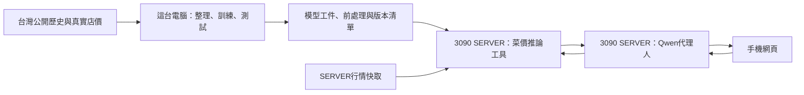

# 期末報告初稿（T33）：現場菜價 7／14 天預測與分析代理人

- 日期：2026-10-03。狀態：**初稿**（T33，依賴之 T27、T32 尚未完成，代理人與 SERVER 段落為設計與本機實作狀態）。
- 當屆期末交付格式未確認（Notion 公告無法讀取，見 [DELIVERY_CHECKLIST](DELIVERY_CHECKLIST.md)），本章節結構為初稿；正式格式公告後再對齊。
- 文中每個數字均標註來源文件或 JSON 檔；未取得證據的項目標「待確認」或「待補」，不編造。負向結果照實呈報。
- 配套投影片大綱見 [FINAL_SLIDES.md](FINAL_SLIDES.md)，兩份文件引用同一組數字。

---

## 1. 問題與動機

一般使用者在蔬果行現場看到單品報價（例如「青江白菜今天一把 45 元」），想知道「現在買，還是可能一週／兩週後更便宜」。現有工具多半只提供當日行情查詢或批發零售倍率換算，沒有以使用者今天這筆店價為基準、固定 7／14 天期限的漲跌預測（見第 2 節查核）。

本專題實作「現場菜價 7／14 天預測與分析代理人」：使用者以手機輸入菜名、今天同店價格與計價單位（上週同店同規格價格選填），系統預測**從使用者今天算起** 7 天與 14 天後的漲跌方向並附分析；代理人以工具呼叫方式整合行情與預測，不自行編造數字（來源：[design.md](../design.md) 第 1、5 節）。

對應課程要求（來源：[DELIVERY_CHECKLIST](DELIVERY_CHECKLIST.md)，逐字稿行號 1710、1711–1712、1240–1247、2832–2844）：

| 課程要求 | 本案對應 | 目前狀態 |
| --- | --- | --- |
| 一定要有一個模型 | 公開市場菜價方向模型（已訓練、封存測試） | 已完成（本機） |
| 領域資料分析代理人 | Qwen 候選＋有限工具呼叫 | 設計完成，SERVER 實測待連線 |
| 量化評估（訓練與展示不同資料） | 時間切分 train／val／test＋凍結清單 | 已完成（公開目標） |
| 可上網操作的成果 | SERVER 部署＋手機網頁 | 本機原型完成，外網待 SERVER |

---

## 2. 相關工作

以下前作均於 2026-10-03 實際查核（WebSearch、GitHub API、Google Play 商店頁、官方文章與 PDF），未安裝 App、未執行他人程式碼。完整矩陣與連結見 [RELATED_WORK_MATRIX](RELATED_WORK_MATRIX.md)。

| 前作 | 做了什麼 | 與本案的關鍵差異（本案另測什麼） |
| --- | --- | --- |
| 農產分析 App（鹿中創客） | 輸入購買價→單位換算→與**當日**果菜市場行情比對價差是否合理；無未來預測 | 本案預測 7／14 天後方向，非當日比對 |
| 農業大數據平台（農委會×財政資訊中心，2018 報導） | 104–106 年 29 億筆電子發票＋批發行情，建 15 項農產品（含甘藍等 8 項蔬菜）零售價格估計與預測模型 | 電子發票通路段估計非單店真值、供內部決策；無消費者現場輸入與 A/B 增益比較 |
| 白菜即時 App（flux6lab，下載 1 萬＋、評分 4.7） | 12 大批發市場即時行情＋AI 批發零售換算＋中長期走勢預測與採購建議 | 未見明確 7／14 天期限、店價輸入與同店到期驗證；模型與準確率未公開 |
| 李岱鑫，清華 2015 | 高麗菜**批發**價預測；使用／不使用中盤商私人紀錄（66 週）的誤差比較 | 私人資料是中盤商紀錄非消費者現場報價；目標批發非零售店價 |
| 陳泯宏，臺大 2024 | 批發價格與方向預測（ARIMA/ETS/TDNN/LSTM，2012–2022） | 批發非零售店價；歷史輸入非未來固定期限 |
| 林沂臻，中山醫大 2017 | 高雄公有零售市場均價 HHT 趨勢與區間預測 | 市場均價非單店；無 7／14 天期限與到期驗證 |
| GitHub 開源（kristenchan/agricultural-product、NCHU-Data-Mining-Project 等） | 批發行情查詢、氣候×菜價探勘 | 查詢／探勘非消費者期限預測；無店價輸入 |

**本案另測的具體組合（查核範圍內未見相同做法）**：以使用者當天在單一店家的現場報價為基準點，預測「從使用者今天算起」固定日曆期限（t＋7／t＋14）的同店相對漲跌；並設計上週價選填的 A/B 兩模式，以真實後續同店到期價驗證增益（來源：[RELATED_WORK_MATRIX](RELATED_WORK_MATRIX.md) 第七節）。單一元件（輸入現價、零售預測、公私資料比較、手機 AI 走勢）各自均有前作，本案不宣稱任何全球首次；「未查到」僅指本輪檢索範圍。

---

## 3. 資料

### 3.1 來源與授權

| 項目 | 內容 | 來源 |
| --- | --- | --- |
| 資料集 | 臺中市政府公有零售市場每日蔬果價格（data.gov.tw dataset 84539） | [DATA_CARD](DATA_CARD.md) |
| 授權 | 政府資料開放授權條款第 1 版（Open Government Data License 1.0） | [DATA_CARD](DATA_CARD.md) |
| 正式快照 | `data/raw/taichung/retail_prices_20261003.json`，SHA256 `172dffc76e82…e7e2e259`，5,323,185 bytes；三次獨立下載 hash 相同 | [DATA_CARD](DATA_CARD.md) |
| 觀測範圍 | 2025-10-04 ～ 2026-10-02，共 364 個日期，無大於 1 天斷點 | [DATA_CARD](DATA_CARD.md)、`prepare_summary.json` |
| 結構 | 4,450 列（市場×訪價日期）× 63 欄；鍵（市場名稱，訪價日期）0 重複 | [DATA_CARD](DATA_CARD.md) |
| 單位 | 元／臺斤（1 臺斤＝0.6 公斤，依標準檢驗局規範；來源頁英文譯 NTD/kg 以中文元/斤為準） | [DATA_CARD](DATA_CARD.md) |

### 3.2 資料契約與品質處置

- **0＝無價格（缺測），不是 0 元**：首版三品項合計 905 格轉缺測，不得當便宜價、持平或 0 元標籤（來源：[DATA_CARD](DATA_CARD.md)、[DATA_QUALITY_REPORT](DATA_QUALITY_REPORT.md)）。
- **14 市場 → 13 市場**：排除「(停)建國市場」（名稱含「(停)」、全期 1,062 列中甘藍沿用價 run 密集，最長 44 天；三品項合計排除 1,105 列長表列）。排除規則凍結於 `scripts/prepare_data.py`，理由＝停用＋沿用價，與測試分數無關（來源：[DATA_QUALITY_REPORT](DATA_QUALITY_REPORT.md)、`prepare_summary.json`）。
- 疑似沿用價（≥10 天完全同價）共 176 個 run；跨市場同日完全同價 1,092 組中 0 組（無複製貼上跡象，但仍屬相關觀測）（來源：[DATA_QUALITY_REPORT](DATA_QUALITY_REPORT.md)）。

### 3.3 首版三品項覆蓋（來源：[DATA_QUALITY_REPORT](DATA_QUALITY_REPORT.md)）

| 品項 | 正價格觀測數 | 價格分佈（元/斤） | 最低覆蓋組合 |
| --- | ---: | --- | --- |
| 甘藍（平地高麗菜） | 3,786 | 12–85，中位 35 | 南屯市場 0%（363 列全缺，走 insufficient_data 路徑） |
| 青江白菜 | 4,355 | 18–100，中位 45 | 南屯 76.3% |
| 絲瓜 | 4,304 | 23–95，中位 50 | 清水第一 62.1% |

不採用來源：臺北市月均價表（月表無逐日日期，不能建日曆日標籤）、高雄市零售每日價（來源已下架 404）（來源：[DATA_CARD](DATA_CARD.md)）。發布延遲無逐筆時間戳，保守假設「觀測日＋1 可見」（`publish_delay_days=1`），實測後需重做敏感度（來源：[DATA_QUALITY_REPORT](DATA_QUALITY_REPORT.md)、[LABEL_CONTRACT](LABEL_CONTRACT.md)）。

---

## 4. 系統架構

三節點分工（來源：[design.md](../design.md) 第 3 節）：

| 節點 | 工作 | 目前狀態（2026-10-03） |
| --- | --- | --- |
| TRAIN_LOCAL（本機 Windows，Ryzen 7 5800X／32GB，CPU 訓練） | 資料整理、特徵、訓練、選模、封存測試、打包、本機 API 與網頁整合 | 已完成 T01–T22（[GLM_PROGRESS](GLM_PROGRESS.md)） |
| SERVER_3090（RTX 3090 24GB） | 載入已訓練工件推論、Qwen 代理人、API 對外服務、行情快取 | **待連線**（T23 HOLD：OS／位址／連線方式未提供，[SERVER_INVENTORY](SERVER_INVENTORY.md)） |
| CLIENT_PHONE（手機網頁） | 填報今天店價、選填上週價、查看 7／14 天結果 | 本機原型已實測（390×844，[UI_FLOW](UI_FLOW.md)）；外網實測待 SERVER |

查詢時只載入已訓練工件推論（`models/releases/0.1.0/`，manifest 含 hash／切分／能力邊界；fixtures 3 案例重現通過）；公開行情更新不等於重新訓練，模型更新先在本機測試再發佈工件，保留可回退版本（來源：[MODEL_CARD](MODEL_CARD.md)、[design.md](../design.md) 第 3、8 節）。本機 API 為 FastAPI（`GET /health`、`GET /metadata`、`POST /forecast`），重用同一推論引擎，12 項真模型包測試通過，推論延遲約 200 ms，目前僅綁 127.0.0.1（來源：[API_CONTRACT](API_CONTRACT.md)、[GLM_PROGRESS](GLM_PROGRESS.md)）。

---

## 5. 方法

### 5.1 標籤契約（T07，凍結）

| 項目 | 定義 | 來源 |
| --- | --- | --- |
| 起點 t | 查詢當下的臺灣日曆日（使用者今天），不是公開資料最新日 | [LABEL_CONTRACT](LABEL_CONTRACT.md) |
| 目標日 | t＋h 日曆日，h∈{7,14}；精確日期配對，缺該日資料不得以前後日暗替 | 同上 |
| 回歸標籤 | r_h = m(t+h)/m(t) − 1（同市場同品項、兩端皆正價格） | 同上 |
| 方向標籤 | r_h＞+5% → up；r_h＜−5% → down；\|r_h\|≤5% → flat（門檻凍結於 D34） | 同上 |
| 缺標籤 | 目標日無正價格 → `insufficient_data`；缺標籤不是「未漲」 | 同上 |
| 標籤成熟 | label_mature_at＝目標日＋1 日（發布延遲保守假設，未實測） | 同上 |

手算邊界例（測試釘死）：30→31.5 元，r＝+0.05 屬 flat；40→42.1 元，r＝+0.0525 屬 up（來源：[LABEL_CONTRACT](LABEL_CONTRACT.md)）。

### 5.2 時間切分與成熟清除（T08，凍結 SHA256 `4e136574…`）

| 切分 | 日期範圍 | 列數 | 日期數 | 來源 |
| --- | --- | ---: | ---: | --- |
| train | 2025-10-04 ～ 2026-05-08 | 13,009 | 214 | `prepare_summary.json` |
| validation | 2026-05-10 ～ 2026-07-21 | 3,855 | 67 | 同上 |
| purged（清除） | 2026-04-25 ～ 2026-07-21 | 1,386 | 30 | 同上 |
| test | 2026-07-22 ～ 2026-10-02 | 4,680 | 73 | 同上 |

切分以日期為單位（同日多市場屬相關觀測，不當獨立樣本）；訓練標籤成熟日最大 2026-05-09 早於驗證起點（斷言通過），清除區隔離 14 天標籤重疊（來源：`prepare_summary.json`、[DATA_QUALITY_REPORT](DATA_QUALITY_REPORT.md)）。全資料標籤分佈：h=7 flat 9,803／down 608／up 541／insufficient 513（合計 11,465 案例，insufficient 佔 4.5%）；h=14 flat 8,907／down 902／up 871／insufficient 785（佔 6.9%）（來源：`prepare_summary.json`）。

### 5.3 特徵（只用查詢時點已可見資料）

最新價與其年齡、7/14/28 天滾動均值／標準差／極值、7/14 天向後報酬、星期／月、品項 one-hot；**無市場 one-hot**（未見市場可推論）。發布延遲假設 1 日：t 當日市場價不作 t 日推論特徵（歷史日期 as-of 特徵由測試釘死，來源：[MODEL_CARD](MODEL_CARD.md)、[ERROR_ANALYSIS](ERROR_ANALYSIS.md)）。

### 5.4 模型候選與選型標準（看測試前凍結）

主指標＝**驗證集方向 macro-F1**（產品核心是漲跌提示；accuracy 被 flat 多數主導）；點預測 MAE 未優於不變價基線者不作點預測宣稱；機率／區間無校準驗證一律不輸出（來源：[MODEL_SELECTION](MODEL_SELECTION.md)）。

驗證集 macro-F1（n：h=7 為 1,967、h=14 為 1,751；來源：`training_results.json`、[MODEL_SELECTION](MODEL_SELECTION.md)）：

| 候選 | h=7 | h=14 |
| --- | ---: | ---: |
| ridge | 0.4183 | 0.3811 |
| hgb_reg | 0.3888 | **0.4591** |
| rf_reg | **0.4334** | 0.4428 |
| hgb_clf | 0.3261 | 0.3624 |
| dummy_majority（全 flat） | 0.2991 | 0.2857 |

選定：h=7 用 rf_reg（RandomForestRegressor，300 樹、leaf≥5、seed 42；train n=6,377）；h=14 用 hgb_reg（HistGradientBoostingRegressor，200 迭代、seed 42；train n=6,134），CPU 訓練（來源：[MODEL_SELECTION](MODEL_SELECTION.md)、`training_results.json`、[MODEL_CARD](MODEL_CARD.md)）。

---

## 6. 量化結果

### 6.1 驗證集（選型用，來源：`training_results.json`、[BASELINE_REPORT](BASELINE_REPORT.md)）

| h | 模型／基線 | return MAE | 方向 accuracy | macro-F1 |
| --- | --- | ---: | ---: | ---: |
| 7 | rf_reg（選定） | 0.0705 | 0.8063 | **0.4334** |
| 7 | flat 不變價基線 | **0.0613** | **0.8139** | 0.2991 |
| 7 | momentum（過去變化延續） | 0.0972 | 0.7794 | 0.4125 |
| 14 | hgb_reg（選定） | 0.1115 | 0.7481 | **0.4591** |
| 14 | flat 不變價基線 | **0.1061** | **0.7499** | 0.2857 |
| 14 | momentum | 0.1461 | 0.7184 | 0.4022 |

持平類佔驗證集約 81%（h=7，1,601/1,967）／75%（h=14，1,313/1,751），「不變價」是點 MAE 與 accuracy 的強基線（來源：[BASELINE_REPORT](BASELINE_REPORT.md)、`training_results.json`）。

### 6.2 封存測試（一次性執行，凍結清單 hash 校驗通過；來源：[PUBLIC_MODEL_EVALUATION](PUBLIC_MODEL_EVALUATION.md)、`public_test_results.json`）

測試區 t：2026-07-22～2026-10-02（73 個日期、13 市場）。

| 期限 | 模型 | n | accuracy | macro-F1 | r MAE | 不變價基線 MAE | 不變價基線 macro-F1 | 不變價基線 accuracy |
| --- | --- | ---: | ---: | ---: | ---: | ---: | ---: | ---: |
| h=7 | rf_reg | 2,085 | 0.7655 | **0.4218** | 0.0664 | 0.0436 | 0.3092 | 0.8647 |
| h=14 | hgb_reg | 1,859 | 0.7106 | **0.4169** | 0.0983 | 0.0748 | 0.2954 | 0.7956 |

結論（僅支持公開市場均價目標）：

1. 方向三類 macro-F1 顯著高於「全預測持平」基線（h=7 +0.113；h=14 +0.122）——模型有超出多數類的方向訊號（來源：同上）。
2. **點預測（相對變化 r）MAE 未優於不變價基線**（0.0664 vs 0.0436；0.0983 vs 0.0748）——點估計僅供參考，每個輸出都附此限制說明（來源：同上）。
3. 準確率低於全持平基線（0.7655 vs 0.8647；0.7106 vs 0.7956）為 macro-F1 取向的已知代價，兩者分開呈報（來源：`public_test_results.json`）。
4. 另如實記錄：測試集上 momentum 基線 macro-F1 為 0.4226（h=7）／0.4306（h=14），與選定模型相當甚至略高——選定標準是在驗證集凍結的，本表不挑選事後較佳者（來源：`public_test_results.json`）。

### 6.3 混淆矩陣與 up 召回（列＝實際，順序 down/flat/up；來源：`public_test_results.json`）

h=7（rf_reg）：[[57, 64, 3], [234, 1523, 46], [43, 99, 16]]；down recall 0.460、up recall 0.101。
h=14（hgb_reg）：[[61, 39, 12], [205, 1237, 37], [74, 171, 23]]；down recall 0.545、up recall 0.086。

| 期限×類別 | precision | recall | support |
| --- | ---: | ---: | ---: |
| h=7 down | 0.171 | 0.460 | 124 |
| h=7 up | 0.246 | **0.101** | 158 |
| h=14 down | 0.179 | 0.545 | 112 |
| h=14 up | 0.319 | **0.086** | 268 |

**負向結果（照實呈報）**：up 類召回率僅 9–10%，模型傾向保守報 flat，「上漲」敏感度有限是本版最大能力限制，回應措辭不得暗示能可靠抓漲（來源：[PUBLIC_MODEL_EVALUATION](PUBLIC_MODEL_EVALUATION.md)、[ERROR_ANALYSIS](ERROR_ANALYSIS.md)）。驗證集亦同：h=7 選定模型 up recall 6/223≈2.7%、h=14 約 16.7%（來源：[MODEL_SELECTION](MODEL_SELECTION.md)）。模型 return bias 為負（h=7 −0.041、h=14 −0.067），整體低估漲幅（來源：`public_test_results.json`）。

### 6.4 分品項（來源：`public_test_results.json`、[PUBLIC_MODEL_EVALUATION](PUBLIC_MODEL_EVALUATION.md)）

| 期限×品項 | n | accuracy | macro-F1 |
| --- | ---: | ---: | ---: |
| h=7 青江白菜 | 703 | 0.671 | 0.392 |
| h=7 甘藍 | 613 | 0.925 | 0.320 |
| h=7 絲瓜 | 769 | 0.724 | **0.447** |
| h=14 青江白菜 | 628 | 0.597 | 0.373 |
| h=14 甘藍 | 544 | 0.855 | 0.307 |
| h=14 絲瓜 | 687 | 0.700 | **0.449** |

甘藍 accuracy 最高但 macro-F1 最低（漲跌事件少、多為 flat）；絲瓜方向訊號最強（來源：[PUBLIC_MODEL_EVALUATION](PUBLIC_MODEL_EVALUATION.md)）。

> 邊界：以上全部是**臺中市場均價**目標成績，不得填入同店準確率欄位（來源：[PUBLIC_MODEL_EVALUATION](PUBLIC_MODEL_EVALUATION.md)）。

---

## 7. A/B 兩種輸入

（來源：[STORE_ADAPTATION_METHOD](STORE_ADAPTATION_METHOD.md)、[design.md](../design.md) 第 1 節）

| 模式 | 輸入 | 輸出與性質 |
| --- | --- | --- |
| A（無上週店價） | 今天店價 p(t)（元/台斤或元/公斤換算）＋公開歷史 | 方向＝公開市場模型 r 預測經 ±5% 門檻；店價估計＝p(t)×(1+r̂)。**正價格錨定不改變方向**——A 的方向完全等於公開市場方向，現價輸入只影響金額換算，不是方向資訊增益。標 `target_scope=store_price_estimate`、`validation_scope=unvalidated` |
| B（有上週店價）＝實驗性規則原型 | 另需上週同店、同品項／規格、同單位報價，且 previous_observed_at∈[t−9, t−5]（7±2 天） | 規則：r_B = r_A + 0.3×(店價一週變化 − 公開同期一週變化)。**已訓練部分：無**——α=0.3 是開發期固定係數，未經任何同店資料擬合。可比性檢查不過→自動回 A 並附原因，不以 0 或市場均價代填 |

- 所有 B 輸出一律帶「實驗性規則（係數 0.3），未經同店資料訓練或驗證」警示與 `validation_scope=unvalidated`；mode=both 時 A/B 並列供比較（來源：[STORE_ADAPTATION_METHOD](STORE_ADAPTATION_METHOD.md)）。
- **T16（真同店 A/B 對照）狀態：HOLD**——配對機制已就緒（T10 協議、T14 路徑、T22 凍結預測紀錄），缺使用者實際同店報價與 7／14 天到期真值；B 是否優於 A 尚無證據，不因公開模型完成而 PASS（來源：[GLM_PROGRESS](GLM_PROGRESS.md)）。
- 禁止事項（程式與測試釘死）：把公開 t−7 欄位改名當「上週私人價」宣稱 B 增益、公開市場分數寫成同店成果、B 缺輸入時杜撰上週價（來源：[STORE_ADAPTATION_METHOD](STORE_ADAPTATION_METHOD.md)）。

---

## 8. 代理人

### 8.1 責任分界

Qwen 代理人負責理解自然語言、呼叫工具與解釋結果；菜價模型負責訓練與推論。代理人不得自行編價格、概率、天氣原因、準確率或已完成的資料分析；工具失敗、資料不足或單位不可比時如實回覆（來源：[design.md](../design.md) 第 5 節）。

### 8.2 工具設計（T26，狀態 TODO——設計凍結，實作可先對本機 API 開發，SERVER 實測待 T25）

| 工具 | 功能 | 限制 |
| --- | --- | --- |
| `get_market_quote` | 取得可用公開行情（來源日、市場、品項覆蓋） | 唯讀；不提供私價 |
| `post_forecast` | 以結構化參數呼叫 `POST /forecast`（品項、市場、今天價／單位／日期、選填上週紀錄、mode） | 有限工具名單、限端點、限呼叫次數與超時；不給任意 shell／任意 URL／修改模型權限 |

自然語言入口 `POST /agent/query`：代理人提取菜名、價格與日期，缺必要資料先要求補充，不自行發明店價；真正執行工具後才回答（來源：[TASKS](../TASKS.md) T26、[design.md](../design.md) 第 6 節）。

### 8.3 忠實原則（T27 忠實性測試，狀態 TODO）

回答不能改變工具方向／數字、捏造原因／機率或將均價說成同店真值；Qwen 不可用時手機仍能顯示直接模型結果與說明——模型失敗時不能用 LLM 編一個替代預測（來源：[TASKS](../TASKS.md) T27、[design.md](../design.md) 第 8 節）。固定中文案例測試涵蓋菜名歧義、單位、無上週價、工具回傳不漲、來源過期、超時與惡意指示（來源：[TASKS](../TASKS.md) T27）。

### 8.4 Qwen 候選（T25，狀態 TODO）

使用者指定 Qwen3.8 為優先候選；實際可取得名稱、大小、量化與工具呼叫支援**待向官方來源核實**，不拿歷史聊天中的型號當證明。計畫在 RTX 3090（24GB）實測載入、峰值顯存、延遲與中文品項理解；CPU 推論跑菜價模型、GPU 跑 Qwen（來源：[TASKS](../TASKS.md) T25、[design.md](../design.md) 第 8 節）。

### 8.5 本機已實作部分

手機網頁（`web/`，無 CDN 依賴）已在本機 API（127.0.0.1:8010）以 390×844 實測：A 模式 7/14 結果渲染、開上週價（28 元、2026-09-26）→ A/B 並排含實驗性警示與資料截止天數、南屯市場正確顯示 `stale_data_unusable` 錯誤；截圖 `outputs/e2e/ui_ab_mobile_390x844.png`。真手機外網操作留待 SERVER 階段（T32）（來源：[GLM_PROGRESS](GLM_PROGRESS.md)、[UI_FLOW](UI_FLOW.md)）。

---

## 9. 限制與未完成

### 9.1 方法限制（來源：[MODEL_CARD](MODEL_CARD.md)、[PUBLIC_MODEL_EVALUATION](PUBLIC_MODEL_EVALUATION.md)、[ERROR_ANALYSIS](ERROR_ANALYSIS.md)）

1. 點預測 MAE 未優於不變價基線——核心價值在方向提示，不在點預測。
2. up 召回率低（h=7 約 10%、h=14 約 9%）——上漲敏感度有限。
3. 僅約一年（364 日）臺中資料，不支持跨年度／颱風事件／其他城市泛化宣稱。
4. 市場均價非單店真值；每格是該市場訪價平均。
5. 發布延遲假設 1 日（未實測）；實測後需重做敏感度。
6. 相鄰日期、跨市場同日列相關；時間切分已控制跨界，樣本數不當獨立觀測解讀。
7. 機率／區間未校準，一律不輸出（null）。
8. 邊界外（明確不做）：囤貨省錢保證、跨年度災害行情泛化、同店 A/B 效果宣稱。

### 9.2 未完成項目（狀態區分，不以文件補成完成）

| 項目 | 狀態 | 缺什麼 |
| --- | --- | --- |
| SERVER 部署（T23–T24、T29–T32） | HOLD／TODO | SERVER 的 OS、位址、連線方式、專案目錄、端口、外網方案（[SERVER_INVENTORY](SERVER_INVENTORY.md)） |
| Qwen 代理人實測（T25–T27） | TODO | SERVER 連線後核實型號並實測工具呼叫與忠實性 |
| 同店真值 A/B 驗證（T16） | HOLD | 使用者實際同店報價與 7／14 天到期真值（[STORE_DATA_PROTOCOL](STORE_DATA_PROTOCOL.md)） |
| 期末影片（T35） | TODO | 當屆規格未確認；需錄真流程（雙模式、SERVER、量化與限制） |
| 外網手機展示（T29、T32） | TODO | 依賴 SERVER；僅同 Wi-Fi／localhost／預錄影片不算完成 |
| 期末交付細則 | 待確認 | 當屆 Notion 公告無法讀取（[DELIVERY_CHECKLIST](DELIVERY_CHECKLIST.md)） |

---

## 10. 分工與時程

### 10.1 分工（**待補**）

組員名單、分工與組長未確認（一組交一份、分組≤4 人、Project 共 25 分——逐字稿 1770–1789、2028–2036，來源：[DELIVERY_CHECKLIST](DELIVERY_CHECKLIST.md)）。**待補：組員姓名與各自負責項目。**

### 10.2 時程（已發生的實際進度）

| 日期 | 里程碑 | 證據 |
| --- | --- | --- |
| 2026-10-03 | 選題查核與前作矩陣（T04）、課程要求對照（T01） | [RELATED_WORK_MATRIX](RELATED_WORK_MATRIX.md)、[DELIVERY_CHECKLIST](DELIVERY_CHECKLIST.md) |
| 2026-10-03 | 資料下載與品質報告（T05–T06）、標籤契約與凍結切分（T07–T09）、店價紀錄協議（T10） | [DATA_CARD](DATA_CARD.md)、[DATA_QUALITY_REPORT](DATA_QUALITY_REPORT.md)、[LABEL_CONTRACT](LABEL_CONTRACT.md) |
| 2026-10-03 | 基線與候選訓練（T11–T12）、選模（T13）、封存測試（T15）、錯誤分析（T17）、打包（T18） | [BASELINE_REPORT](BASELINE_REPORT.md)、[MODEL_SELECTION](MODEL_SELECTION.md)、[PUBLIC_MODEL_EVALUATION](PUBLIC_MODEL_EVALUATION.md)、[MODEL_CARD](MODEL_CARD.md) |
| 2026-10-03 | A/B 店價適配（T14）、本機推論與 API（T19–T20）、手機網頁（T21）、預測紀錄（T22） | [STORE_ADAPTATION_METHOD](STORE_ADAPTATION_METHOD.md)、[API_CONTRACT](API_CONTRACT.md)、[UI_FLOW](UI_FLOW.md) |
| 待定 | SERVER 連線→部署→Qwen 實測→代理人→外網手機（T23–T32） | 依使用者提供 SERVER 資訊 |
| 待定 | 同店 A/B 到期驗證（T16）、期末影片與發布（T35） | 依使用者記錄店價與當屆細則 |

**待補：期末報告期限、口頭報告日期、影片長度（當屆細則未確認，不沿用期中「約 10 分鐘」為硬規則）。**

---

## 附錄：數字來源對照

| 數字 | 來源檔 |
| --- | --- |
| 資料集 84539、SHA256、4,450 列、364 日期、905 缺測格、元/台斤 | [DATA_CARD](DATA_CARD.md) |
| (停)建國排除 1,062 列、176 沿用 run、南屯甘藍 0%、品項觀測數與價格範圍 | [DATA_QUALITY_REPORT](DATA_QUALITY_REPORT.md) |
| 切分列數（13,009/3,855/1,386/4,680）、凍結 SHA256、標籤分佈、成熟日斷言 | `outputs/data_quality/prepare_summary.json` |
| 驗證集候選與基線全表、train_n 6,377/6,134 | `outputs/training/training_results.json`、[MODEL_SELECTION](MODEL_SELECTION.md)、[BASELINE_REPORT](BASELINE_REPORT.md) |
| 封存測試總表、混淆矩陣、分品項、momentum 測試值、return bias | `outputs/evaluation/public/public_test_results.json`、[PUBLIC_MODEL_EVALUATION](PUBLIC_MODEL_EVALUATION.md) |
| up 召回驗證集 2.7%／16.7%、輸出欄位允許條件 | [MODEL_SELECTION](MODEL_SELECTION.md) |
| B 規則 α=0.3、7±2 天可比性、A 錨定性質 | [STORE_ADAPTATION_METHOD](STORE_ADAPTATION_METHOD.md) |
| 拒絕與降級代碼、能力邊界 | [ERROR_ANALYSIS](ERROR_ANALYSIS.md) |
| 課程要求、分組與期中/期末區分 | [DELIVERY_CHECKLIST](DELIVERY_CHECKLIST.md) |
| 任務狀態（T16/T23 HOLD、T25–T27 TODO 等） | [TASKS](../TASKS.md)、[GLM_PROGRESS](GLM_PROGRESS.md) |
