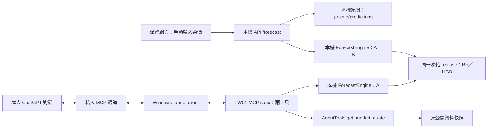

# TW01 新結論：保留表單網頁，新增個人 ChatGPT 插件

日期：2026-10-13。這份文件記錄使用者最新方向；[階段 TASK](TASKS.md) 與 [ChatGPT／COS 工作提示詞](COS_HANDOFF_PROMPT.md) 為同一工作包。

**目前完成的是結論與任務安排；產品改碼、私人通道及真 ChatGPT 驗收皆 NOT_RUN。** 本包不宣稱產品 EXTERNAL_PASS。使用者先前「動手」已授權此方向的後續實作；最新要求讓 Codex 先交付文件，再由 ChatGPT 用 Windows COS 執行。歷史設計中的「等設計確認」不再要求重問同一範圍。

## 1. 決定與範圍

| 項目 | 本次決定 | 邊界 |
| --- | --- | --- |
| 原專題網頁 | 保留，以表單輸入現場菜價，不依賴 GLM | 保留原 A／B、單位、精確日期及本機紀錄；移除 GLM 聊天入口 |
| 新增入口 | 在本人 ChatGPT 使用 TW01 個人 MCP 插件 | 第一版只查公開行情、做 A 預測；不新增自訂 UI 卡片 |
| 預測來源 | 沿用凍結 ForecastEngine：RF 7天、HGB 14天 | 不重訓、不換資料、不改指標或 B 的固定 α=0.3 |
| GLM／Hermes | 不接入這兩條新運行路徑 | 舊 provider／Hermes source 與憑證保留，不擴大重寫 |
| Qwen／RTX 3090 | 暫緩 | 不查、連線、啟停或部署 3090，不改 Qwen 設定 |
| 插件 B／保存 | 後續另議 | 網頁既有 B／保存仍保留；不讓插件讀取全體私人紀錄 |
| 發布 | 本機網頁＋本人私人連線 | 不公開上架、不開入站防火牆、不 push／commit 或課程發布 |

「GPT 插件」在本包指 ChatGPT 的個人 MCP 工具連線；不是把 OpenAI 模型 API 塞進原網頁。COS 是 ChatGPT 操作本機檔案與命令的工具，與 TW01 插件通道是兩回事。

## 2. 目標架構

網頁與 MCP 是各自的程序，分別載入同一份凍結 release；不共用記憶體 engine 或 HTTP 保存暫存。ChatGPT／通道離線時，網頁仍應能預測與管理本機紀錄。插件的數字直接來自原工具／引擎，不走 `/agent/query`、GLM、Hermes 或 Qwen。

通道需 Windows 開機與程序持續運行。私人通道使用出站連線；個人 ChatGPT 的自訂 MCP 能力與 Platform organization 的 Tunnels Read／Manage／Use 權限需分別實查。tunnel-client 需要實際 tunnel_id 與通道 runtime API key，這不是本插件呼叫模型 API 的金鑰；本人登入與工作區選擇由本人完成。帳號資格、費用及可用模型尚未核實，不保證免費或無限使用。[OpenAI 私人 MCP 通道文件](https://developers.openai.com/api/docs/guides/secure-mcp-tunnels)

帳號缺項只 HOLD 接線與 ChatGPT 驗收；已授權的本機實作、網頁驗證、紀錄及交付照常完成。不得自行借用 Claude／GLM 憑證、轉公開轉送、切換帳號或購買訂閱。

## 3. 現況查核與必要修復

本輪讀原始碼與最新 Proposal 外審；HEAD 是 `9e29cddce8687489dcd07bc2f8d673d2e0a72ce3`，工作區已有多處未提交修改及未追蹤產物。不得 reset、clean 或將前輪內容歸零。後續 DE00 必須重新查現況，不能靠此快照替代。

| 原始來源 | 查到的行為 | 後續任務 |
| --- | --- | --- |
| `src/aiot_price/agent/local_web.py` | 啟動依賴 GLM 專用 KEY 與設定 | 新增獨立 manual launcher，不沿用 GLM launcher |
| `src/aiot_price/api/app.py:200`、`:203`、`:222`、`:295` | 頂層載入 agent service；status 解析 provider；rule 分支仍可能建立 QwenBackend | 隔離首次 import、status、query 三條路徑；不能只設 profile=rule |
| `web/index.html:20`、`web/app.js:229` | 仍有聊天區及 bindAgent 初始化 | 移除聊天區與 agent 請求，保留表單／紀錄 |
| `src/aiot_price/api/app.py:153`、`:185`；`api/prediction_records.py` | /forecast 走原引擎並登記本程序 request_id；保存依賴此暫存 | MCP 直接用引擎；網頁紀錄回歸使用 server-only 隔離目錄，預設位置不變 |
| `src/aiot_price/agent/tools.py:419`、`:449` | 真工具為 get_market_quote、post_forecast；行情 age 是截止日時年齡 | 沿用兩工具，另計查詢日時年齡，不能稱今日即時行情 |
| `src/aiot_price/models/predict.py:211` | 使用輸入日期計算 t+7／t+14；歷史日也會出現「今天」警告 | adapter 固定台北日曆日並註明「報價基準日」，不改引擎 |
| 原 `protected_before.json` | 14組基準未含兩個 joblib 與 public_history.parquet | 原14逐檔照驗；另補本輪 release 全5檔基準，禁止替換原基準 |

前輪給的 `http://127.0.0.1:8766/` 曾由 GLM launcher 啟動；本輪沒有實查現在的 listener／PID。它不是 manual 網頁已切換的證據。DE09 查明程序身分後才可逆重開本專題；身分不明則用空閒 loopback port，交付實測網址。

## 4. 第一版工具契約

兩工具的 schema 與 dispatch 均須白名單驗證；annotations 只是提示，不能代替實際限制。標 `readOnlyHint=true`、`destructiveHint=false`、`openWorldHint=false`，拒絕額外欄位、任意 URL、路徑、程式碼及不存在的工具。

| 工具 | 輸入 | 真實結果與限制 |
| --- | --- | --- |
| get_market_quote | crop_id＝cabbage／bok_choy／sponge_gourd；market_id＝原 KNOWN_MARKETS 清單 | 公開均價、元／台斤、實際觀測日、快照截止日、台北查詢日、截止日時與查詢日時年齡；缺測或日期未知回受控錯誤 |
| post_forecast | crop_id、market_id、current_price、price_unit；選填 observed_on | 僅 A；固定 without_last_week、7／14天、store_id=null；不保存私人觀察紀錄 |

current_price 必須為非 bool、有限且大於0的數值。price_unit 只接受 `NTD_per_taiwan_jin`／`NTD_per_kg`。observed_on 須為嚴格 YYYY-MM-DD 有效日；未填用 server 的 Asia/Taipei 今天，拒絕未來日期，轉為該日 `T12:00:00+08:00` 再交引擎。目標日為精確日曆 t+7／t+14，不以最後資料日計算。

回傳 JSON structuredContent 與受控事實文字：實際輸入回顯、日期、原價格與方向、單位、模型／資料版本、截止日、原警告與尚無同店驗證的限制。機率／區間保持 null。原警告的「今天」若保留，明確註明指報價基準日 t。既有引擎輸出數值不由 adapter 或 ChatGPT 重算改寫。

缺價格／品項／市場應追問；B、保存或任意執行請求應說明本版限制，不能假造結果。回顯只能證明工具收到哪些參數，不能證明與原聊天逐字相符或已經真人確認。ChatGPT 自由文字不會自動通過網頁 validator，DE11 必須逐項對原 tool JSON 核對。[OpenAI 連線與 ChatGPT 驗證流程](https://developers.openai.com/plugins/deploy/connect-chatgpt)

stdio stdout 只放協定，診斷走 stderr；單 worker 串行。單次工具上限15秒，以可終止的 worker／程序實作並實測，不能拿 thread timeout 常數宣稱硬終止。第一版超時後由操作者人工重開，測協定恢復；不得假設 tunnel-client 自動重建。

## 5. 不變的領域限制

公開市場均價不是個店真值；0表示無報價／缺測，不能當零元。A 使用當日單店價＋公開歷史；網頁 B 另用同店同品項同規格可比的上週價，α=0.3 是固定規則。不可拿公開 t−7 冒充私人上週價。

真店 A／B 到期配對仍無證據；合成輸入及市場測試均不證明單店準確率。既有公開測試未勝全部簡單基線，須保留負向結果；正式完整精度以 `outputs/evaluation/public/public_test_results.json` 為準。LLM 不得猜價格、機率、省錢、未經校準區間或天氣因果。

Qwen、3090、真店驗證、外網多人、插件 B／保存、影片與對外發布各自 HOLD，不由本工作包順帶啟動。

## 6. 執行、審查與文件效力

DE00–DE12 的依賴、改檔白名單、指令、輸出與停點見 [TASKS.md](TASKS.md)。ChatGPT 透過 **Windows COS** 是下一輪執行者；使用者此次明示角色安排優先於 AGENTS.md 的舊「GLM 執行者」措辭，但作者不能自簽 EXTERNAL_PASS。另有獨立 reviewer 才能記錄相應範圍的外審；同一作者重查只能是 SELF_CHECK。獨立子代理人的審查也應寫明身分與範圍，不冒稱使用者／正式 ChatGPT 外部驗收。

最新既有 [REVIEW_R3.md](../../../outputs/audits/proposal_v5_r3_independent_20261009_01/REVIEW_R3.md) 只驗收 Proposal v5 r3，不驗收此產品插件。原 TASKS 的 T01–T36／Proposal 歷史不改字樣；新增 DE 工作包只更新最新執行方向。

本文件取代前輪設計中的待確認排程；歷史 r2 原檔保留於 `outputs/quality_runs/chatgpt_dual_entry_design_20261013_02/`。本輪只新增這三份文件與根 TASKS 的入口；產品、依賴、服務、帳號設定及憑證均未改。文件查核證據另存 `outputs/quality_runs/chatgpt_dual_entry_handoff_20261013_01/`。
