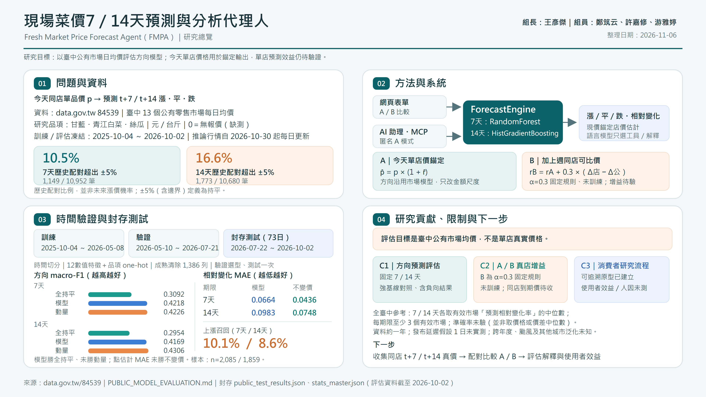

# Proposal Document｜現場菜價 7／14 天預測與分析代理人

**Fresh Market Price Forecast Agent（FMPA）｜期中研究提案（Proposal Document）**

組長：**王彥傑**｜組員：**鄭筑云、許嘉修、游雅婷**｜正式發表日期：待填

[設計藍圖](../../design.md) · [研究補充與文獻八欄表](RESEARCH_NOTES.md) · [公開封存測試結果](public_test_results.json)

*圖為本研究的資料、方法與評估摘要；數值、母體及限制以本文與封存測試 JSON 為準。*

## Abstract（A–F）

**A — 問題情境。** 消費者在蔬果行看到今天甘藍一台斤 32 元，想知道「從今天起 7 天或 14 天後，相對現在會漲、平還是跌？」臺中政府提供公有零售市場每日價格，但那是市場均價，不是眼前店家的價格。

**B — 研究缺口。** 前作已有批發／市場價預測、當日買價比對、私有紀錄增益等不同能力；在本次文獻查核範圍內，尚未看到「當日單店報價錨定＋固定 7／14 日曆期限＋真店到期 A/B 配對評估」整套組合。這是查核範圍描述，不是原創性宣稱。

**C — 解法。** 使用者只輸入品項、今天價格及單位；上週同店同規格價可選填。系統用公開歷史預測市場方向，A 以今天店價錨定店價估計，B 以選填的上週價作實驗性調整，兩者都標示驗證範圍。

**D — 方法。** 以臺中 13 個公有市場 2025-10-04～2026-10-02 每日零售均價（元／台斤）建立相對變化標籤，固定 t+7／t+14 與 ±5% 持平定義；時間切分、標籤成熟清除、驗證集選型，最後使用封存測試與簡單基線比較。

**E — 結果。** 7／14 天方向 macro-F1 為 **0.4218／0.4169**，均未勝動量基線 **0.4226／0.4306**；相對變化 MAE **0.0664／0.0983** 也未勝不變價 **0.0436／0.0748**；上漲召回只有 **10.1%／8.6%**。

**F — 發現。** 系統建立了可重現的公開市場評估與低輸入負擔原型，但尚未證明能準確預測個別店價或改善採買決策。B 的增益、真店 A/B 及使用者效益都需要到期實測。

## 1. Introduction（A–F）

### A–B：動機與背景

臺中政府開放資料 [data.gov.tw 84539](https://data.gov.tw/dataset/84539) 記錄公有市場的每日均價，可供建立有日期與來源的比較基準。消費者卻常只知道當下某間店的標價，沒有可比的長期私有紀錄；單位、品種、促銷和公開資料發布延遲，都會影響判讀。

本案三品項的公開歷史配對中，7 天脫離 ±5% 持平區的比例為 **1,149／10,952（10.5%）**，14 天為 **1,773／10,680（16.6%）**。分母是市場×品項×起算日的可配對歷史觀測，不是未來漲價機率。多數持平，少數變動，故不能只用 accuracy 呈現效果。

### C–D：問題與既有限制

現有研究能預測市場價或比對當日買價，尚不能直接證明「使用者這家店的 7／14 天方向」。本案以三個研究問題收束：

| 研究問題 | 已取得的證據 |
| --- | --- |
| **RQ1** 公開零售均價方向預測是否勝過簡單基線？ | 有封存測試；勝全持平，但未勝動量與不變價 MAE |
| **RQ2** 今天價 A、再加上週價 B 是否改善同店到期預測？ | A/B 規則與配對協議已有，**真店增益尚無證據** |
| **RQ3** 能否降低輸入負擔並維持來源、期限、限制可追溯？ | 網頁及 MCP 原型可用；全面解釋與人因效果未驗 |

### E–F：差異與貢獻

- **C1（已完成研究評估）**：固定 7／14 日期、時間切分、強基線和包含負向結果的公開市場評估。
- **C2（待驗證設計）**：現價錨定 A、上週店價 B，及同店到期配對驗證協議；B 使用固定 α=0.3，未經真店資料訓練。
- **C3（原型）**：低輸入負擔、標示來源／預測期限／驗證範圍的使用者介面，效益待驗。

下文依序呈現 Related Work、Proposal 與初步評估；完整文獻表、五個核心思維、三個專業爭論與十個深問題集中在[研究補充](RESEARCH_NOTES.md)。

## 2. Related Work

### AI Technology 與 Domain Know-how 各約半數

**AI 技術**：蔬菜價格研究已有 ARIMA、LSTM 等序列方法 [R01]，HHT [R03]、決策樹 [R07]，以及最接近的 Team17 [H17] 以 LightGBM 結合市場與氣象資料預測五天市場價格。**領域知識**：批發→零售的通路差異 [R04]、天災後 1–3 週供需變動 [W1]、私有通路資料的額外資訊 [R02]、消費者現場買價比對 [R06]，顯示「同店、同品項、同規格、同單位、同時間」是必要條件。

| 比較 | Team17（同課程歷屆） | 本專題 |
| --- | --- | --- |
| 目標 | 六品項市場價格的未來五日預測與購買指南 | 以使用者當日店價為基準，固定 t+7／t+14 的方向 |
| 輸入 | 批發行情／交易量／氣象 | 臺中零售市場均價＋當日店價；上週同店價選填 |
| 評估 | R²、RMSE、MAE（該組簡報結果） | macro-F1、相對變化 MAE、同集基線；真店 A/B 待驗 |

**差異是研究對象與驗證協議，並非使用不同模型就稱創新。** Team17 的 R² 不能與本案 macro-F1 直接比較；比較依可取得的簡報內容，未重現其模型。完整八欄文獻摘要、來源網址、閱讀層級（abstract／page／report／full）與 UNKNOWN 規則見[研究補充 §2、§6](RESEARCH_NOTES.md)。

## 3. Proposed Scheme

### 3.1 資料、目標與領域規則

| 項目 | 定義 |
| --- | --- |
| 公開來源 | 臺中 13 公有零售市場每日均價；首版測試品項是甘藍、青江白菜、絲瓜 |
| 日期與單位 | 訓練及封存評估資料 2025-10-04～2026-10-02；元／台斤，1 台斤＝0.6 公斤 |
| 缺測 | 原資料 0 表示無報價；不當零元、不補造私人價格 |
| 預測期限 | 使用者今天 t 的**精確日曆日** t+7、t+14；不因最新行情較舊而改變起點 |
| 相對變化 | r_h = m(t+h) / m(t) − 1（m 是同市場、同品項均價；需兩日期皆可用） |
| 方向 | r > +5% 為漲；r < −5% 為跌；**−5% ≤ r ≤ +5% 為持平（含邊界）** |
| 特徵 | 僅用預測時前一日 t−1 以前可得的 12 個數值特徵＋品項 one-hot |

### 3.2 防止未來資訊洩漏

以日期為群組切分，同一天所有市場留在同一區段；訓練到 2026-05-08、驗證從 2026-05-10 到 07-21、封存測試從 07-22 到 10-02。考慮公布延遲 1 天的保守假設，標籤在 t+h+1 才成熟；跨界未成熟列剔除，兩個邊界共 **1,386 列**（訓練→驗證 695、驗證→測試 691）。此數字是兩期限與兩界的列數總計，不是獨立日期數。

### 3.3 模型選型與 A／B 假設

比較候選回歸與分類器，以**驗證集方向 macro-F1** 選型，再評估封存測試：**7 天 RandomForest（RF）、14 天 HistGradientBoosting（HGB）**。不是按測試成績事後改選。基線是全持平／不變價、動量與訓練均值變化。

A 模式：今天正店價 p 乘上市場預測相對變化，得到 **p̂_A(t+h)=p(t)×(1+r̂_h)**。因 [p(1+r̂)−p]/p=r̂（p>0），A 只改金額錨點，**不會改善或改變相同 ±5% 分類器的方向**。

B 模式：有可比的上週同店價時，以 **r_B=r_A+0.3×(Δ店7日−Δ公開同期)** 調整；0.3 是固定實驗規則，**並非訓練學到的權重或經實證的增益**。日期不在 7±2 天、換店／規格或單位不可比則回 A 並提示。完整流程、Architecture、Flowchart 與帶行號 Pseudocode 見[設計藍圖](../../design.md)。

### 3.4 封存測試與基線結果

| 期限／模型 | 封存有效樣本 n | 方向 macro-F1 | 全持平 macro-F1 | 動量 macro-F1 | 相對變化 MAE（模型／不變價） | 上漲召回 |
| --- | ---: | ---: | ---: | ---: | ---: | ---: |
| 7 天／RF | 2,085 | **0.4218** | 0.3092 | **0.4226** | **0.0664／0.0436** | **10.1%**（16／158） |
| 14 天／HGB | 1,859 | **0.4169** | 0.2954 | **0.4306** | **0.0983／0.0748** | **8.6%**（23／268） |

*資料：首版三品項、臺中市場均價封存測試；兩期限的 n 不同。MAE 是「預測相對變化 r」的絕對誤差均值，並非元或店價準確率。測試值皆按原始精度四捨五入；[公開封存 JSON](public_test_results.json) 保存完整數字。沒有顯著性檢定、門檻敏感度或特徵消融。*

方向 macro-F1 勝全持平，**但 7／14 天均未勝動量**；點估計 MAE **均未勝不變價**，因此店價點估計只能作參考。上漲類召回偏低，不適合當可靠的漲價警報。公開市場均價的測試分數也**不能當成單店準確率**。

### 3.5 目前系統與驗證邊界

`使用者（手機網頁／AI 助理）→ 網頁 API 或 MCP 兩工具 → ForecastEngine（模型程式運算）→ 結構化預測／依結果解釋`。LLM 可理解提問與選工具，**不得自行猜價格或補造失敗工具的答案**。

| 入口 | 實作現況 | 主要限制 |
| --- | --- | --- |
| [網頁](https://161.33.19.220/web/) | 61 個品項欄位，60 個有行情可預測；A/B；網頁紀錄存在使用者自己的瀏覽器 | 原三品項 RF/HGB；其他 57 品項共用 HGB，後者留出測試誤差同樣未勝不變價 |
| AI 助理的 [MCP](https://fresh-market-price-agent.prometheans152.workers.dev/mcp) | **只有 `get_market_quote`、`post_forecast` 兩個工具**；60 品項、13 個市場，匿名 A | 沒有 B、保存或私人店價；`/records` 是本機 API，不是第三個 MCP 工具 |
| 未指定市場的查詢 | `post_forecast.market_id=all_markets`：各有效市場分期限預測相對變化率，分別取中位數 | **全臺中參考值未做樣本外準確率測試**；`get_market_quote` 仍須指定公有市場 |
| 資料更新 | 訓練／封存評估固定至 2026-10-02；推論用公開行情自 2026-10-30 起每日更新 | 更新行情不代表重訓，也不代表驗證了最新分布的準確率 |

ChatGPT 已有**一條**匿名 A 的真實工具對話成功：品項、價格與單位齊全，未指定市場時直接使用 `all_markets`，未追加追問市場。其他情境、全面自然語言解釋、Gemini 及真店到期 A/B 效果未驗證。

## 4. 後續驗證與期中交付

**真店 A/B 協議**：同一批已取得上週價的案例，事前同時凍結 A、B 預測、觀測日、單位與來源版本；在 t+7／t+14 收集**同店同品項同規格**的實價，逐案例配對比較方向與誤差。缺到期價記「無法核對」，不能當沒漲。另須測試全臺中聚合、人因效益、門檻敏感度與不同資料期間的可靠性。

| 期中項目 | 入口或狀態 |
| --- | --- |
| 研究報告（Abstract／Introduction／Related Work／Proposed Scheme） | 本 Proposal；[研究補充](RESEARCH_NOTES.md) |
| Design MD（設計藍圖） | [design.md](../../design.md) |
| 原生簡報 | [FMPA_Midterm.pptx](../../slides/midterm_minimal/FMPA_Midterm_Minimal.pptx) |
| PDF | [FMPA_Midterm.pdf](../../slides/midterm_minimal/FMPA_Midterm_Minimal.pdf) |
| 簡報講稿 | [SLIDE_NOTES.md](../../slides/midterm_minimal/SLIDE_NOTES.md) |
| YouTube、GitHub 教授存取、課程提交 | **尚未完成或待確認** |

本專題使用 AI 協助資料整理、程式、文稿與呈現；數值與主張需回查程式和資料，最終解釋與答辯責任由團隊承擔。

## 5. 執行與原始證據入口

本機安裝、Web 操作與歷史 Demo 請見 [README：Installation／How to Run／Demo](../../README.md)；資料契約、執行流程及 API／CLI 對照見[設計藍圖](../../design.md)。

[封存測試 JSON](public_test_results.json) 的 `horizons["h=7"]`、`horizons["h=14"]` 含選中模型與全持平／動量基線的 macro-F1、相對變化 MAE、up recall、混淆矩陣；它是**公開均價**的既有封存結果，不等於店家實價。原始逐列 CSV／母體統計及模型 manifest 與此封存版本對應，詳見[研究補充的來源說明](RESEARCH_NOTES.md)。

## 6. References

原論文、政府資料、Team17 與其他來源的完整書目、連結、查核層級及 UNKNOWN 說明，統一列於[研究補充 §6](RESEARCH_NOTES.md)；本案資料來源為[臺中公有市場每日行情（84539）](https://data.gov.tw/dataset/84539)，原封存結果見[公開測試 JSON](public_test_results.json)。本提案沒有新增未查證的研究結果。
